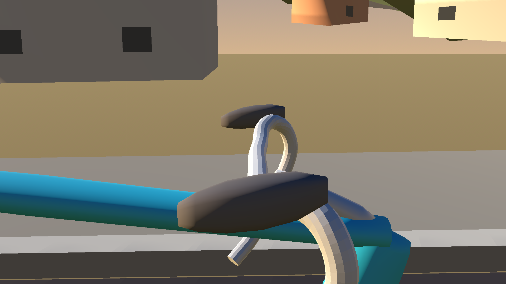
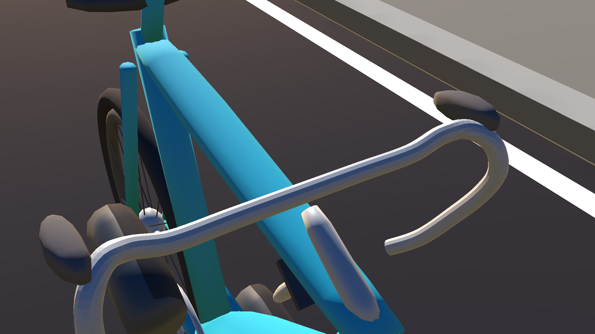
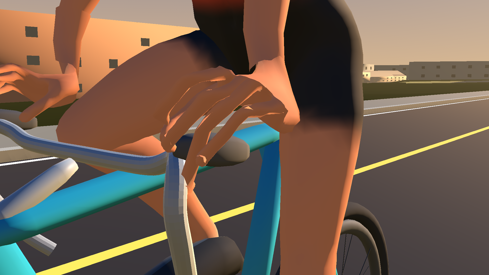
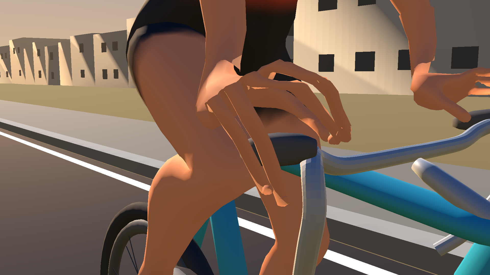
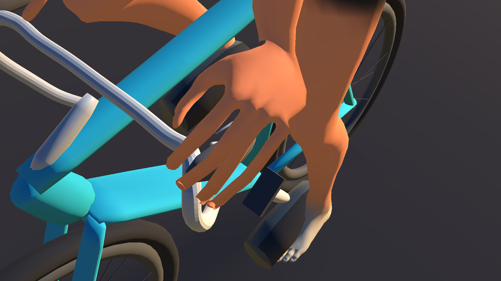
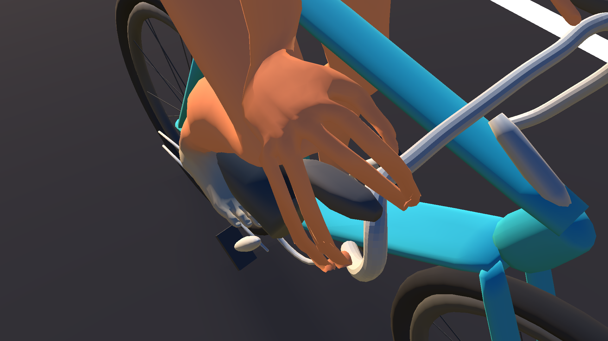
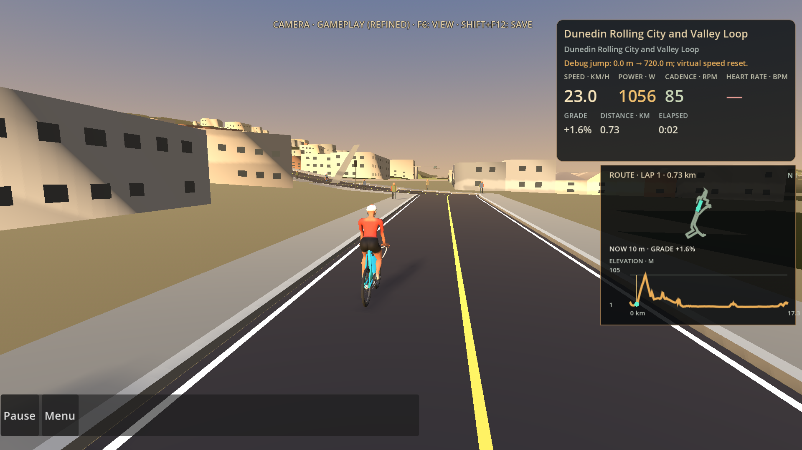

# Cockpit and hood-grip comparison — v22

Draft PR #94 evidence, captured from the production RideScreen on Godot 4.6.2 / OpenGL Compatibility at 1500×900. The GLB shown is `WodraCyclist-alpha48-cockpit-v22.glb`; it was imported into the normal route scene before capture.

## Photographic references

- [SRAM AXS controls: side/profile and design details](https://www.sram.com/en/learn/tech-deep-dives/axs-controls)
- [SRAM AXS road setup photographs](https://www.sram.com/en/learn/road-axs-welcome-guide)
- [SRAM hand resting on the hood](https://www.sram.com/globalassets/publicsites/03_learn/sr/road-axs-2x/welcome-guide-fival-update/04_fps_force-rival-shifter-update.jpg?format=jpg&quality=90&w=950)
- [Full rider on the hoods](https://www.cyclingweekly.com/fitness/marginal-gains-everybody-318503)

The SRAM photographs guided the unbranded model silhouette. No third-party photographs are included in this repository.

## Current model, same ride scene

| View | Production capture |
|---|---|
| Cockpit without hands, side |  |
| Cockpit without hands, front three-quarter |  |
| Left hand on hood |  |
| Right hand on hood |  |
| Left hand elevated |  |
| Right hand elevated |  |
| Normal chase view |  |

[Continuous production RideScreen clip](godot-motion-v22.mp4): 360 frames at 30 fps, including pedalling, right steering, coast and restart.

## Review status

The bar is now one continuous swept drop-bar shape. The hood is tapered and narrower than the earlier bulbous version, and has a separate curved lever blade. However, in the close runtime captures the hood still reads too much like a capsule, and the fingers look long and flat instead of wrapping naturally. Distance/contact and export regressions pass, but the visible hand/cockpit defect remains unresolved. Keep PR #94 draft and unpublished pending another correction and owner review. Issue #93 is separate and is not claimed fixed.
