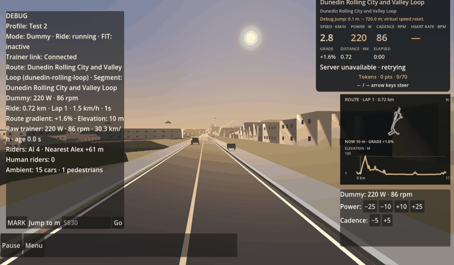

# Alpha.53 ambient car review evidence

Rendered in Godot 4.6.2 with the production RideScreen and Dunedin Rolling City route, after jumping to 720 m. A controlled production-route car started 55 m behind the player while four AI riders were loaded. The test sampled the live RideScreen rider group and drove the actual `AmbientActorManager` and `AmbientCarVisual`. The run used the Quadro P620 and a 1280×720 logical window.

## Motion capture

The 60-frame runtime capture shows a vehicle approach, maintain clearance, pass, and return to its route lane. The three PNGs are unedited frames from that run.

## Reproductions and corrections

On alpha.52, two cars on perpendicular paths both stopped at 0 m/s before the crossing and stayed there beyond 40 seconds. At the failed state their centers were `(-2.610, 0, -1.700)` and `(1.700, 0, -3.810)` with 1.175 m envelope clearance. Their reciprocal look-ahead caused both to yield. The regression now gives deterministic right-of-way, and both cars clear without envelope overlap (crossing frames 72 and 128, minimum sampled clearance 0.237 m).

The alpha.52 overtake controller also cleared its target after just one 60 mm lateral step. On Oval Gardens the car passed the rider but stayed at 0.21 m instead of returning to its 1.70 m travel lane, with no remaining target. The fix retains the overtake state until the car reaches its base lane. A curved-path regression and production route tests verify the complete return.

Final controlled RideScreen runs passed on Rolling City with four AI riders (minimum vehicle/rider envelope clearance 1.281 m; player closest approach 1.28 m) and on Oval Gardens (2.962 m). Same-direction following is independently checked against a stopped car and pedestrian, including 250 ms low-frame-rate updates.

Issue #28 remains open for owner physical acceptance. No cyclist behavior was changed.
