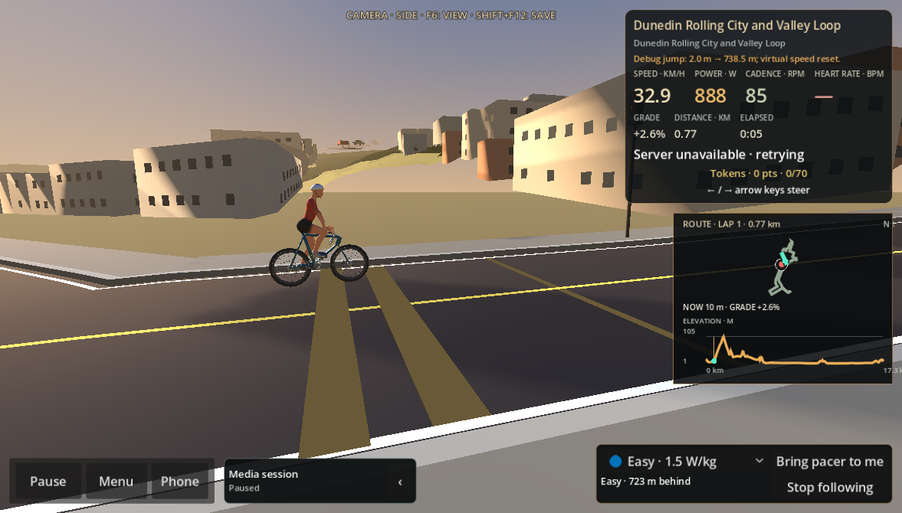
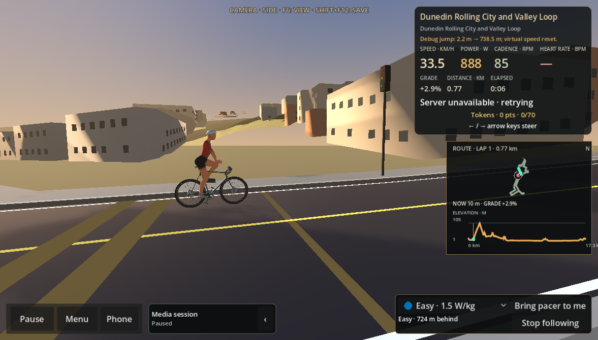
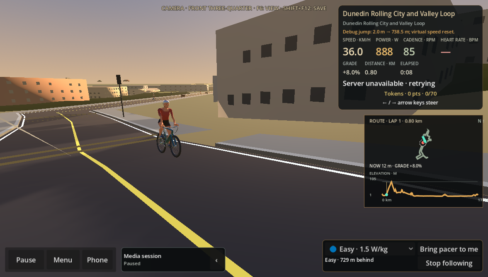
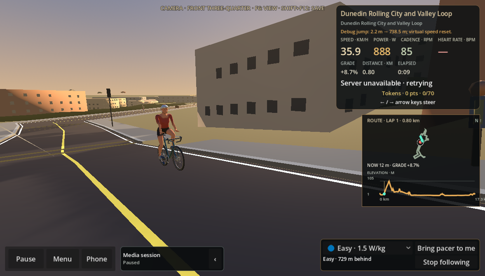
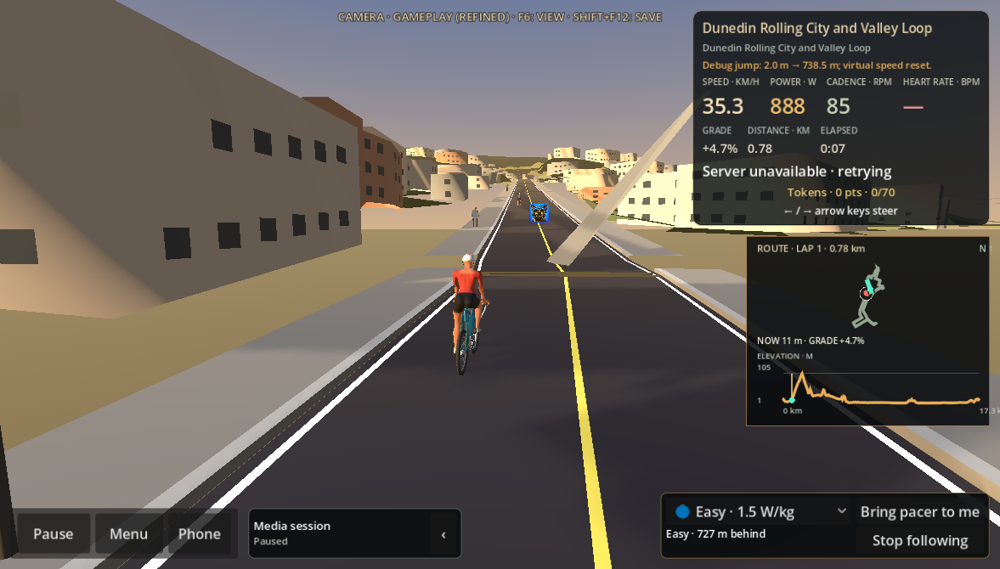
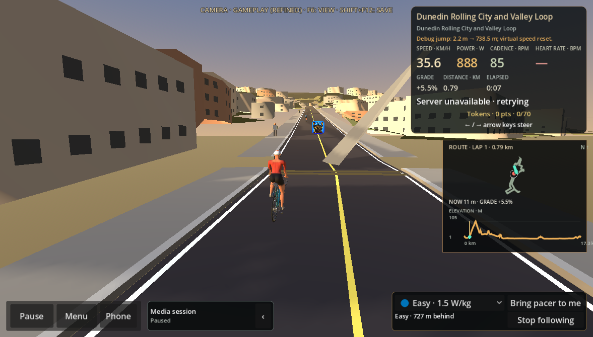
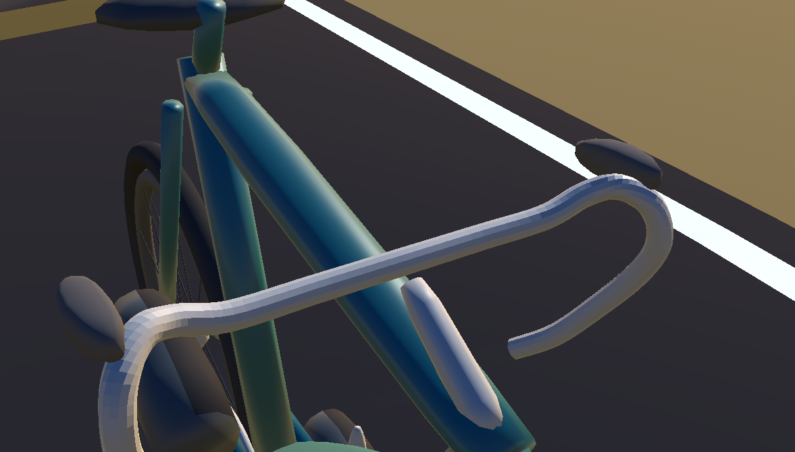
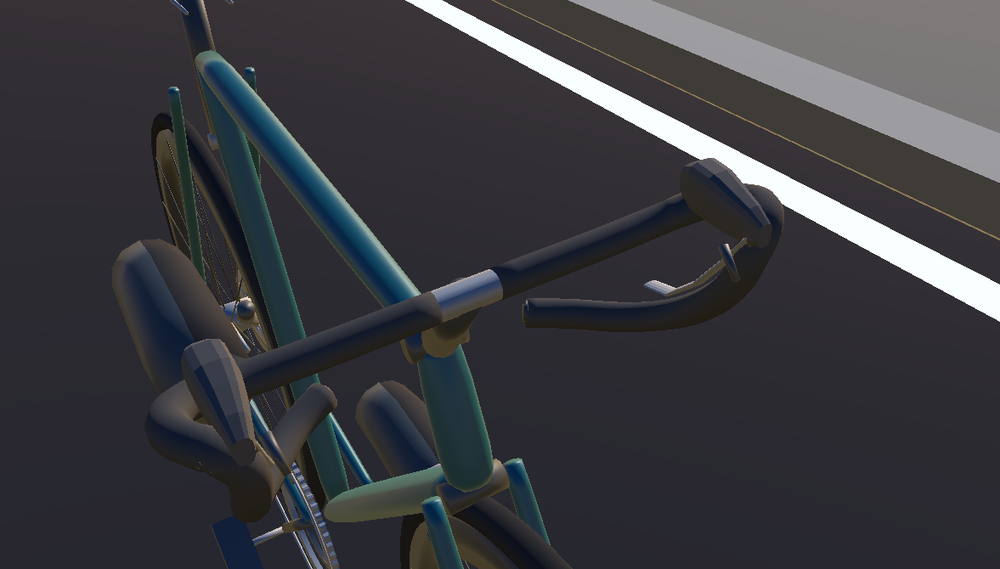
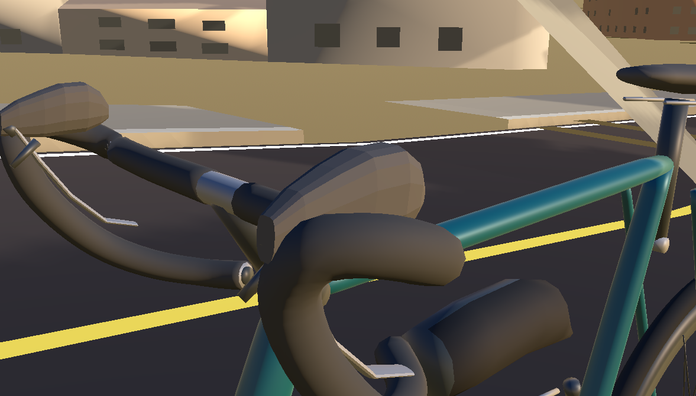
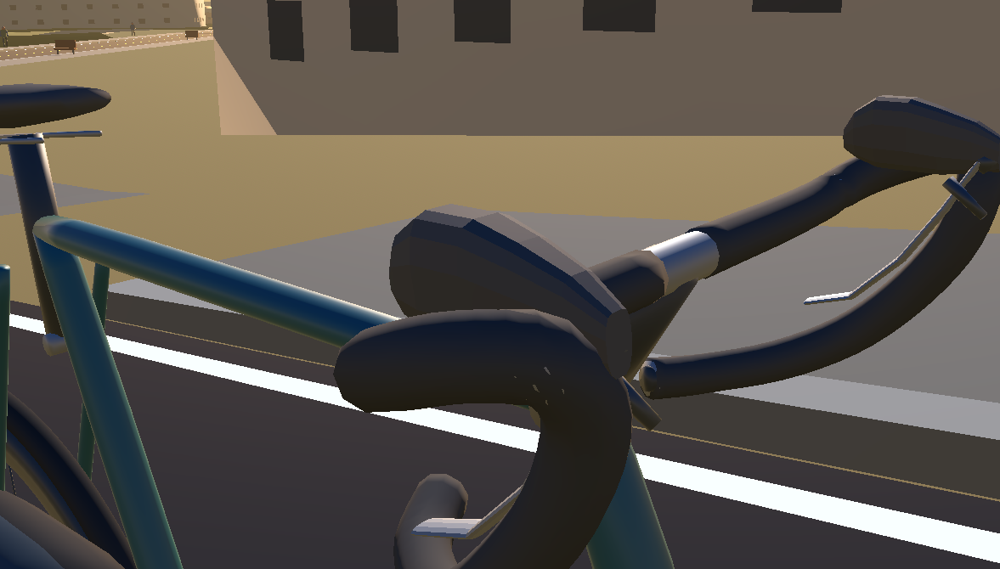

# Issue #158 road bike visual review

The matched images below were captured in `RiderFinishingSceneReviewTest.tscn`
using the production `RideScreen`, imported cyclist GLB, production rider camera
views, route lighting and the same 1177×670 viewport. `before/` loads the
`origin/main` GLB; `after/` loads the #158 GLB. The review harness hides only
the route collectible visual so it cannot cover the front-three-quarter view.

| View | Before | After |
| --- | --- | --- |
| Side |  |  |
| Front three-quarter |  |  |
| Chase |  |  |
| Cockpit, no hands |  |  |

Individual brifter close-ups after the wider swept lever-blade refinement:

[12-second production RideScreen motion capture](evidence/after-motion.mp4) includes
pedalling, steering input, coasting and restart. It uses the dummy trainer in a
disposable review scene; no physical trainer/hardware test is claimed.

The existing rider's hands and pelvis do not fit the revised target locations.
That is visible in the rider-on-bike view and measured by
`verify_hand_hood_contact.py`; refitting remains #159 by design.
