# Issue #158 road bike visual review

The matched images below were captured in `RiderFinishingSceneReviewTest.tscn`
using the production `RideScreen`, imported cyclist GLB, production camera
views and identical 1920×1080 Godot viewports. `before` loads PR #160's prior
head (`dd317d9`); `after` loads the current candidate. The review harness hides
only the rider for bike-only views and hides the route collectible that can
cover the front-three-quarter view.

| View | Before | After |
| --- | --- | --- |
| Side | 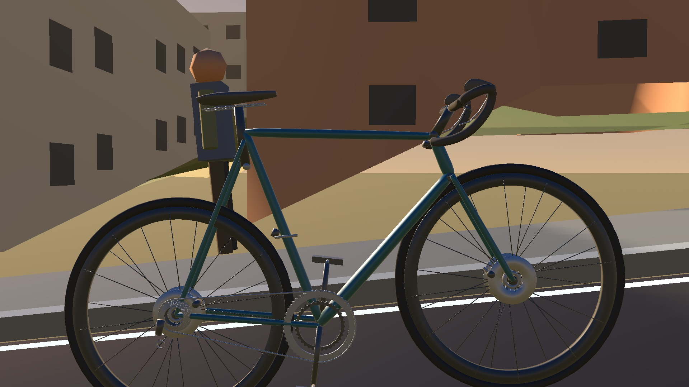 | 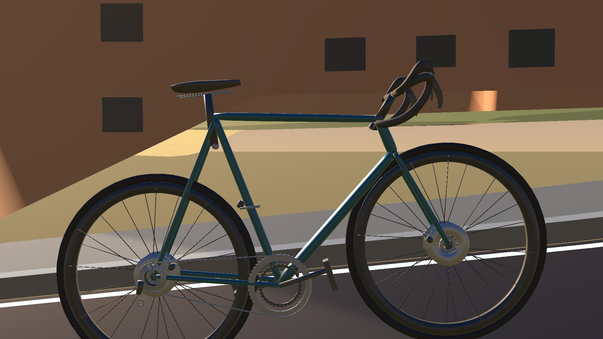 |
| Front three-quarter | 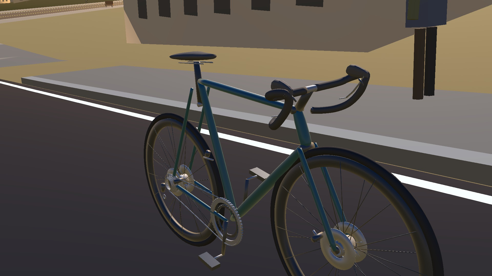 | 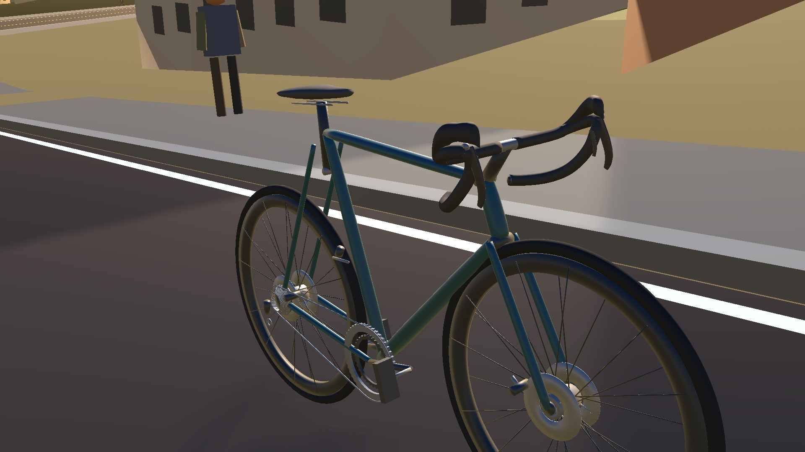 |
| Chase | 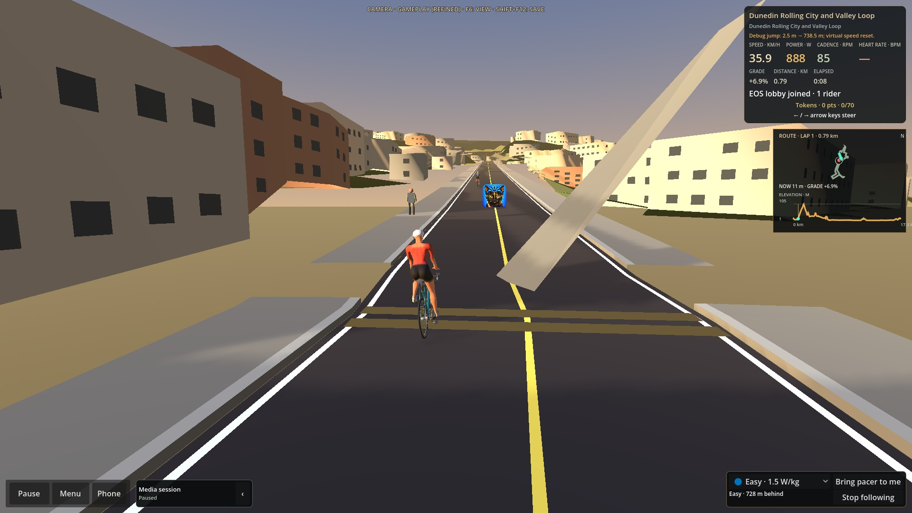 | 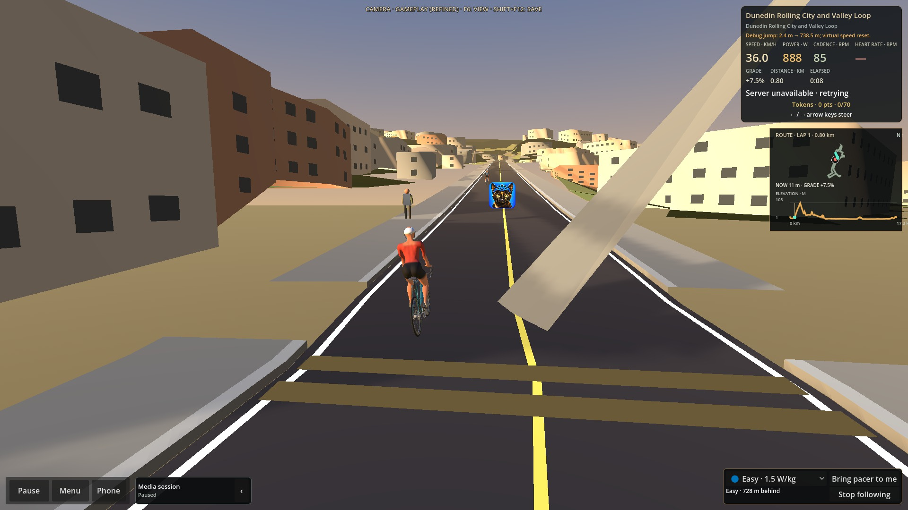 |
| Cockpit, no hands | 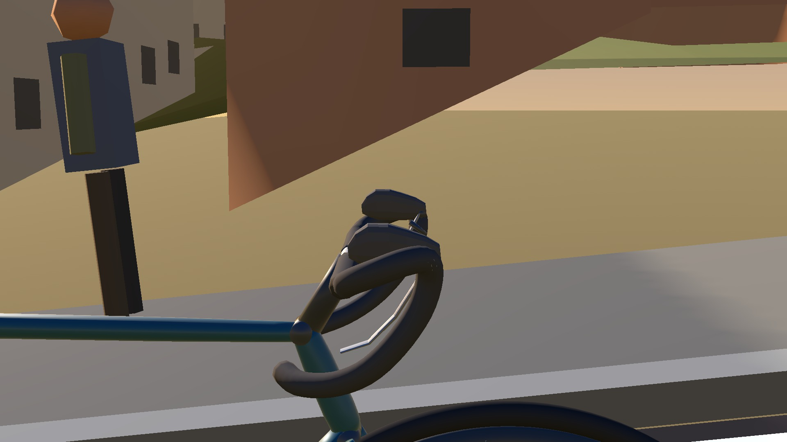 | 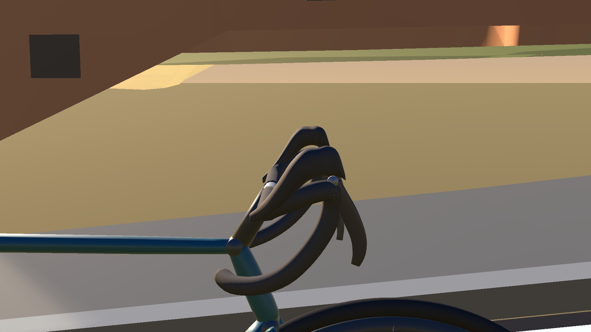 |

The owner-provided Trek Émonda and Shimano 105 photographs were used as shape
references and are not redistributed in this repository. Matched, no-hands
hood close-ups:

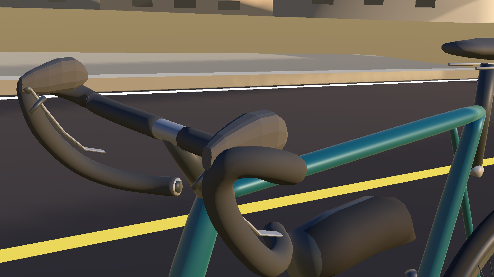
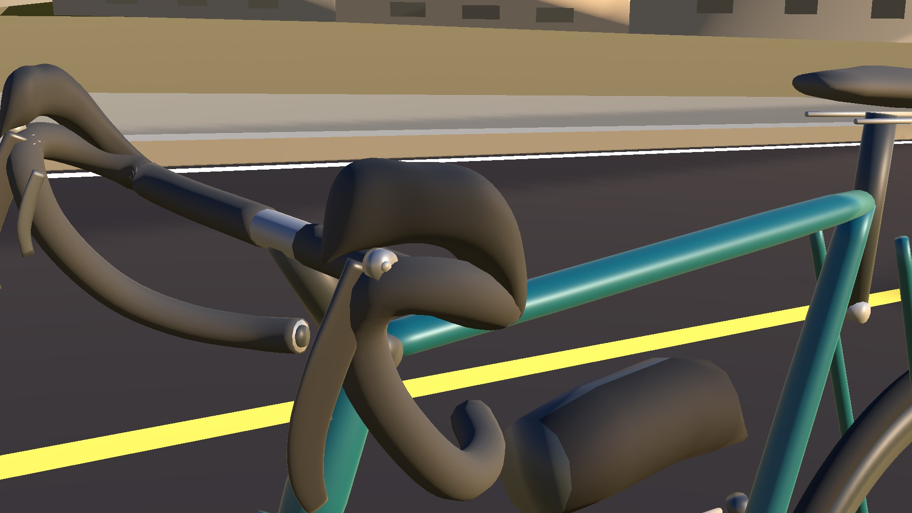
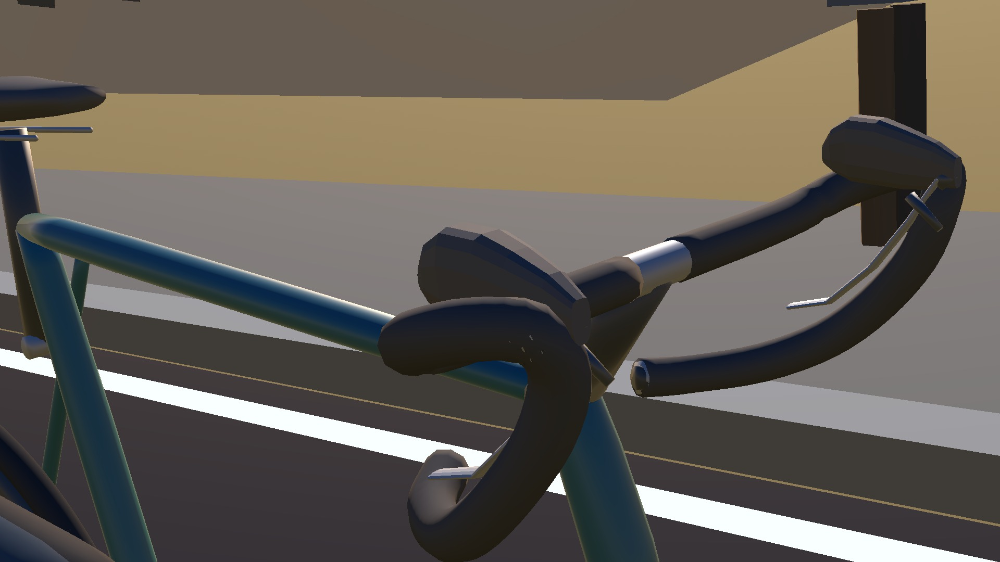
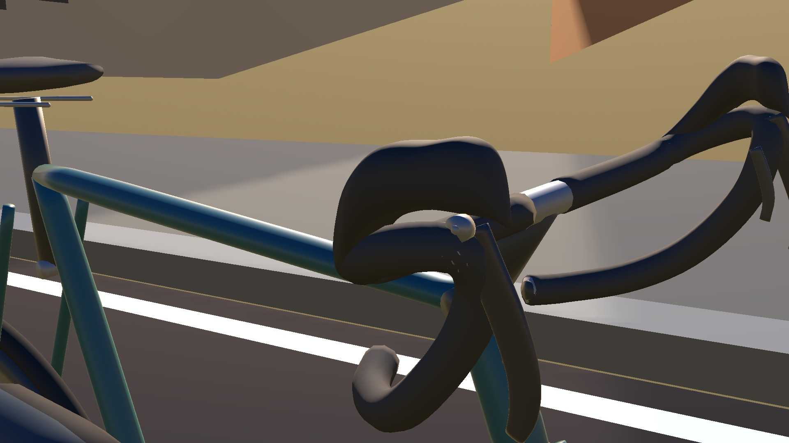

[Matched production RideScreen motion captures](evidence/before-motion.mp4) and
[after](evidence/after-motion.mp4) include pedalling, steering input, coasting,
and restart. They use the dummy trainer in a disposable review scene; no
physical trainer/hardware test is claimed.

The existing rider's hands and pelvis do not fit the revised target locations.
That is visible in the rider-on-bike view and measured by
`verify_hand_hood_contact.py`; refitting remains #159 by design.

The exported model has 78,074 triangles and 49 meshes (the prior PR head has
65,338 triangles and 48 meshes). Both remain under the existing 100,000-triangle
and 75-mesh guards. This is a geometry-budget comparison, not a frame-time
benchmark.
