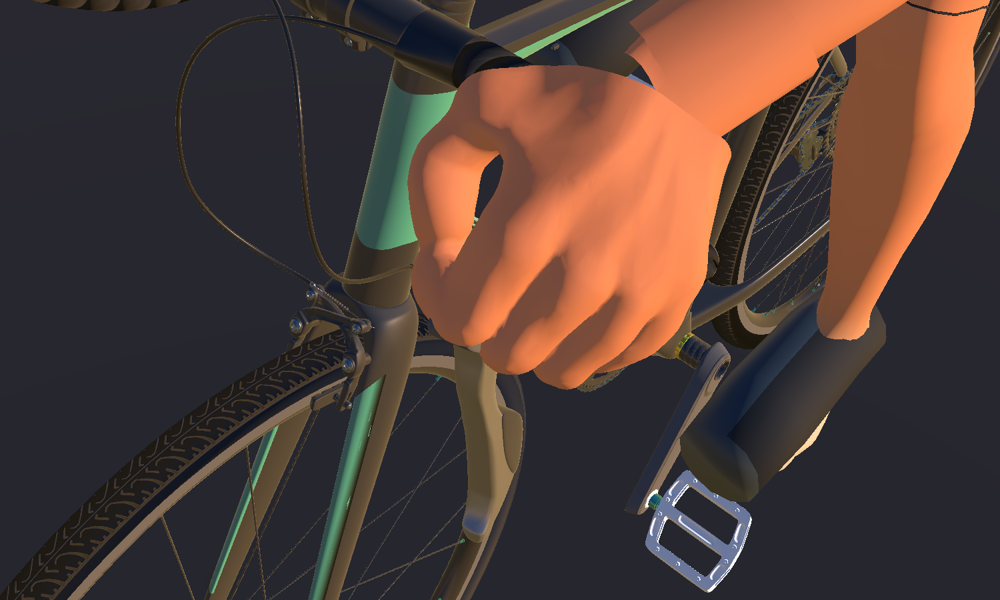
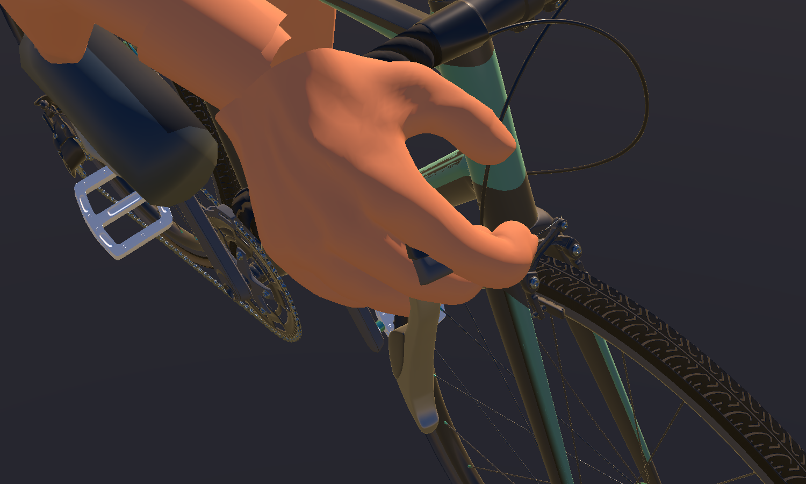
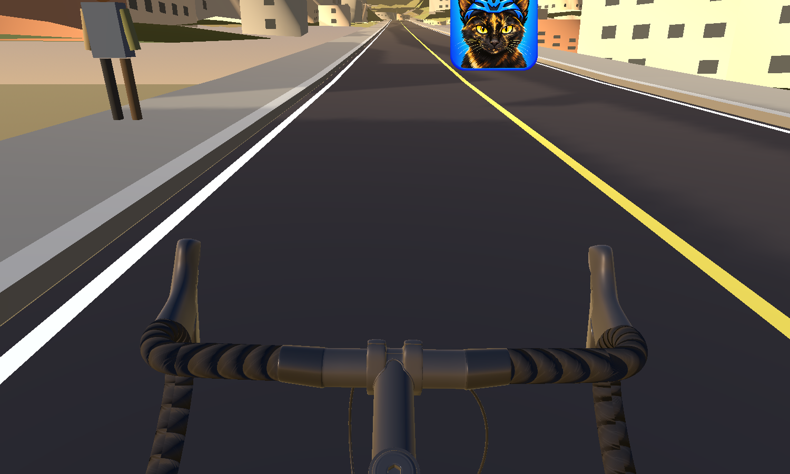

# Issue #159 — production rider and hood-grip review

All stills are captures from the production `RideScreen.tscn` with the imported
candidate in Godot 4.6.2 on the NVIDIA Quadro P620. The before and after hand
close-ups and elevated views are matched at 1500×900 with the same review
cameras. The older full-body baseline captures are 1177×670; the new full-body
captures are 1500×900, so those compositions are comparable but not pixel-size
matched. The motion test rendered 360 production frames at 30 fps; this host's
display limited each frame to 1177×670. The accepted Alpha.84 CGTrader bicycle
is unchanged.

## Rider fit

| Original baseline side | Current fitted rider side |
| --- | --- |
|  |  |

| Original baseline chase | Current fitted rider in gameplay chase |
| --- | --- |
|  |  |

The new model retains the PR's accepted forward cycling posture, fitted jersey,
bib shorts, shoes and helmet. This hand pass did not alter the bicycle or change
the rider's torso, pelvis, legs, or clothing mesh.

## Hands on the hoods

The prior Wodra hand pose had visibly stretched fingers hanging past the hood.
The current hand surfaces come from the closed road-control grip in the
owner-supplied Andy Woodhead cyclist model (CC BY 4.0). The actual Godot renders
below show the complete source grip geometry fitted to the Wodra hood surfaces.
The owner's photograph at `C:\Users\garet\OneDrive\wodra\images\bike\IMG_1465.JPEG`
was inspected as the primary grip reference and remains external; it is not
redistributed in this PR.

| Left hand, previous | Left hand, current |
| --- | --- |
|  |  |

| Right hand, previous | Right hand, current |
| --- | --- |
|  |  |

The elevated views show the palm support and opposed thumb around each control:

| Previous left elevated | Current left elevated | Previous right elevated | Current right elevated |
| --- | --- | --- | --- |
|  |  |  |  |

This is a visible improvement over the prior open, extended-finger silhouette:
the replacement fingers curl around the hood/lever body and the thumb closes
on the inboard side. The mesh remains stylized and somewhat broad compared
with a photoreal hand. Each hand is a single posed sculpture rigidly attached
to its wrist; its fingers do not articulate independently. The images are
provided for owner visual acceptance, which has not yet been granted.

## Motion

[12-second production RideScreen clip: pedalling, steering, coasting and restart](after/pedalling-steering-coast-restart.mp4)

| Pedalling | Steering | Coast | Restart |
| --- | --- | --- | --- |
|  |  |  |  |

Godot's production `RiderMotionReviewTest.tscn` captured 360 frames at 30 fps
and passed its steering displacement and phase assertions. Both wrist-following
grips remain in the production ride during cadence, steering, coast and resume.

## Fit and performance checks

`RiderFinishingSceneReviewTest.tscn` passed in the production RideScreen and
sampled 72 phases across `PedalCycle`. It measured maximum sculpted
palm-contact-to-hood distance of 0 mm left and right, pelvis-to-saddle distance
of 96 mm, and ankle-origin travel of 5–340 mm. These are fit/continuity checks;
the screenshots remain the evidence for visual shape. The exported
`palm_contact.L/R` frames follow the wrist. The rider and accepted bicycle retain
their existing animation interfaces.

The final GLB contains 958,119 triangles across 25 render meshes and is
32,536,224 bytes. The pre-hand baseline contains 947,270 triangles across 25
meshes and is 36,912,232 bytes: the sculpture adds 10,849 triangles (+1.15%)
while the exported file is 4,376,008 bytes smaller (-11.86%). No separate
GPU-time or multiplayer frame-time benchmark was run for this rider-only
change, so the smaller file is not presented as a frame-rate improvement. The
owner should still check visual quality and physical riding acceptance on the
Windows gaming machine. No BLE/ANT+ hardware or real ride was tested here.

The Godot test processes report pre-existing renderer/Resource RID leak
warnings during shutdown after their PASS markers. They still exited zero on
the final graphical production runs. This is the isolated headless/scene
shutdown issue tracked by #56; no engine changes are included in this PR.
