# Issue #159 production RideScreen review

All images below were captured from the production `RideScreen.tscn` in Godot
4.6.2 using the NVIDIA Quadro P620 renderer. Still views use a 1500×900 review
viewport; the motion review ran 360 frames at 30 fps with a 960×540 requested
window (the host produced a 1177×670 viewport). The bicycle is the accepted
Alpha.84 CGTrader model.

## Before and after

The matched production side and chase views compare the original upright rider
with the current fitted rider. Full-view captures are included below as well.

| Original baseline | Fitted production view |
| --- | --- |
| 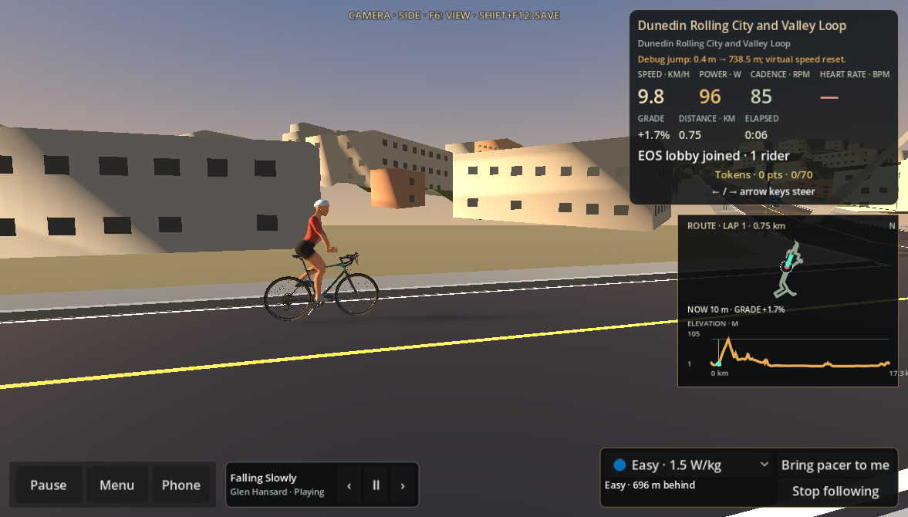 | 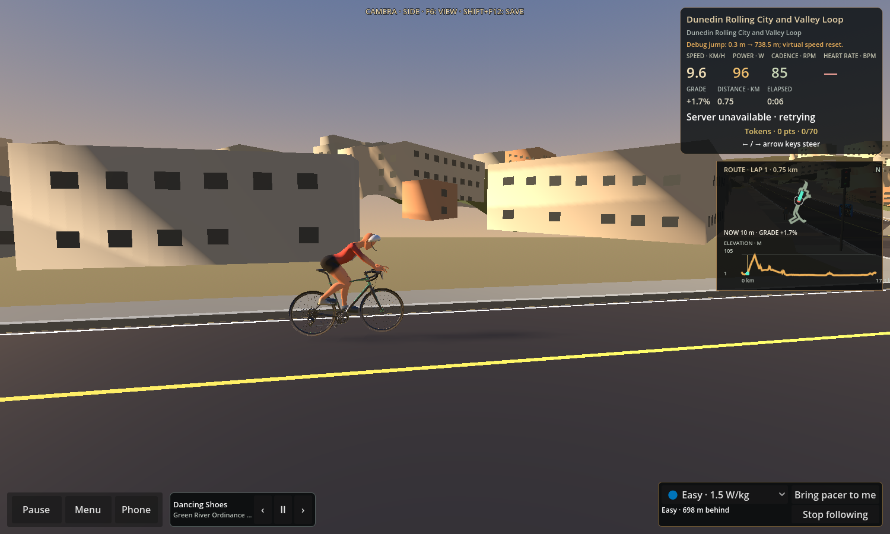 |

| Original chase view | Fitted production chase view |
| --- | --- |
| 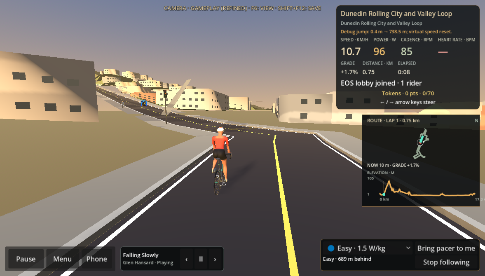 | 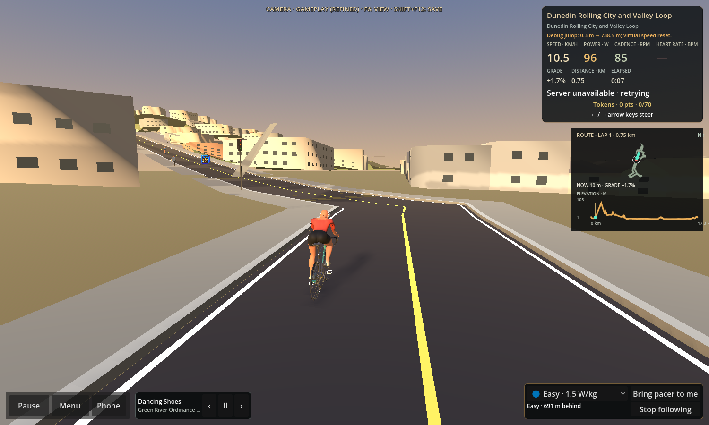 |

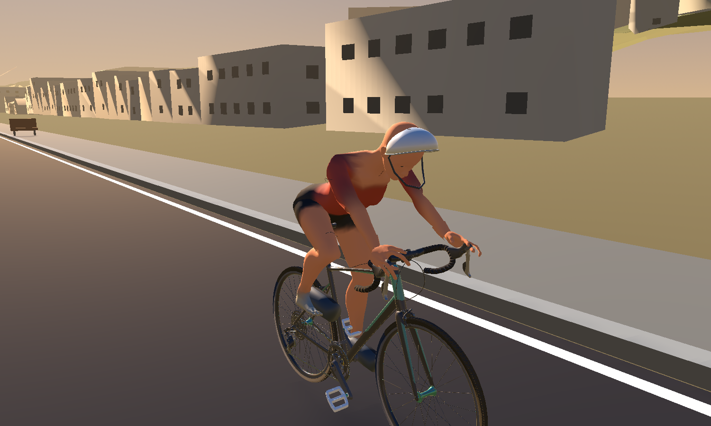

The full side and front-three-quarter close views are from the final RideScreen
test. The original baseline RideScreen captures used a 1177×670 window while
the current fit review uses a 1500×900 SubViewport. The before/after side and
chase images use the same named production camera views, but their viewport
aspect ratios differ.

## Hood grip close-ups

These are close production captures of each hand throughout the imported
`PedalCycle` pose. The palms seat at the established hood shelves; finger
contact is less convincing than the owner’s closed grip photograph and remains
the main visual limitation for review.

| Left hood | Right hood |
| --- | --- |
| 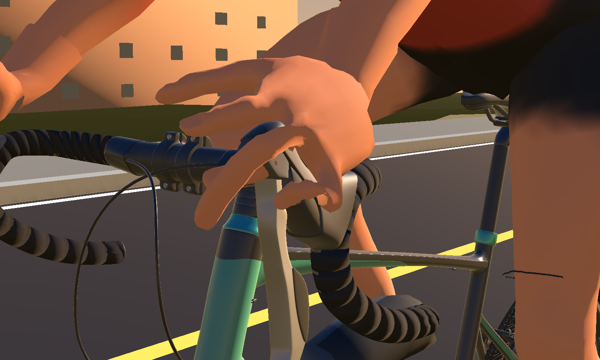 | 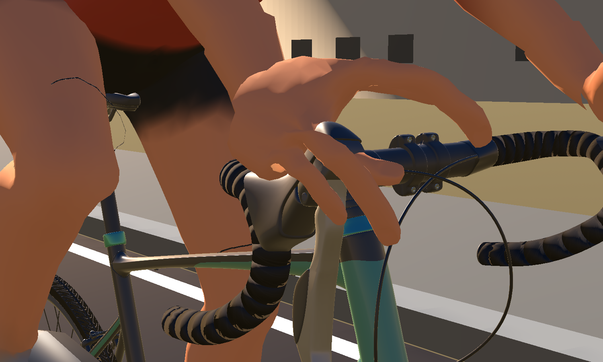 |

## Motion

[12-second production RideScreen clip: pedalling, steering, coasting and restart](pedalling-steering-coast-restart.mp4)

Selected production frames:

| Pedalling | Steering | Coast | Resume |
| --- | --- | --- | --- |
| 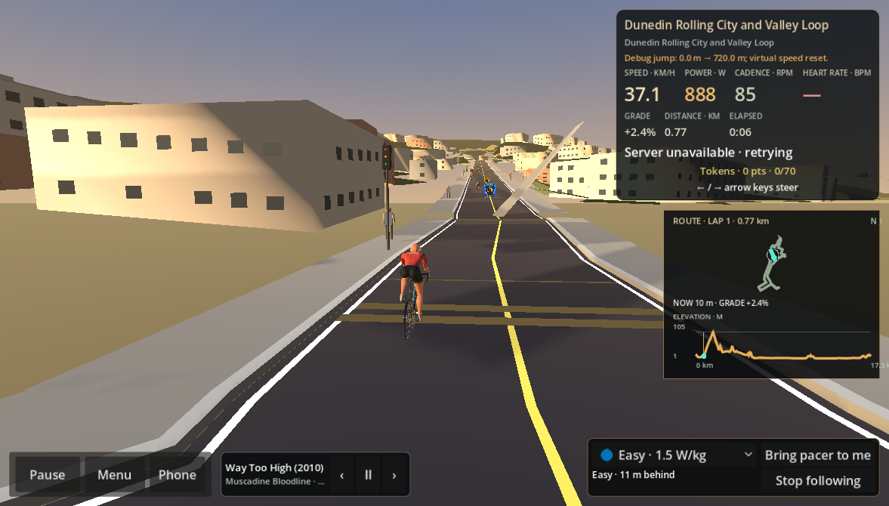 | 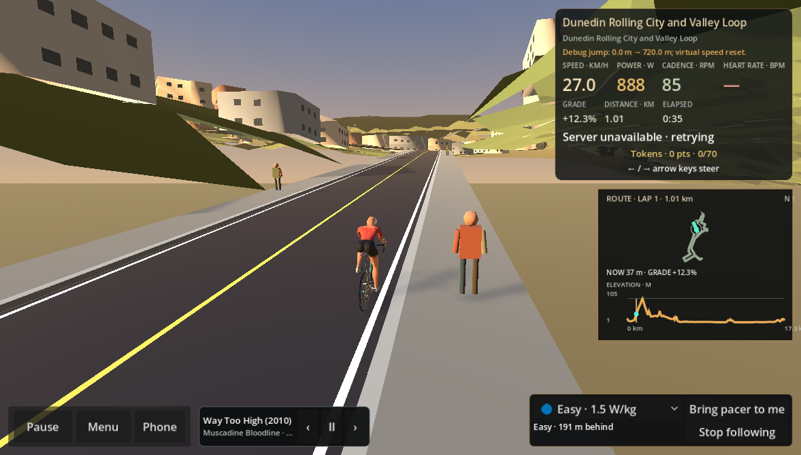 | 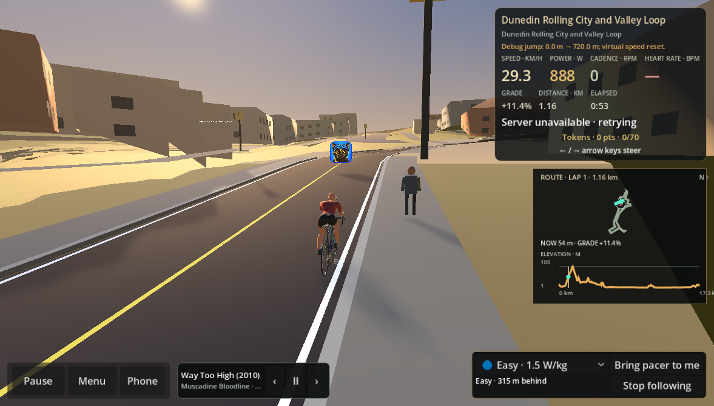 | 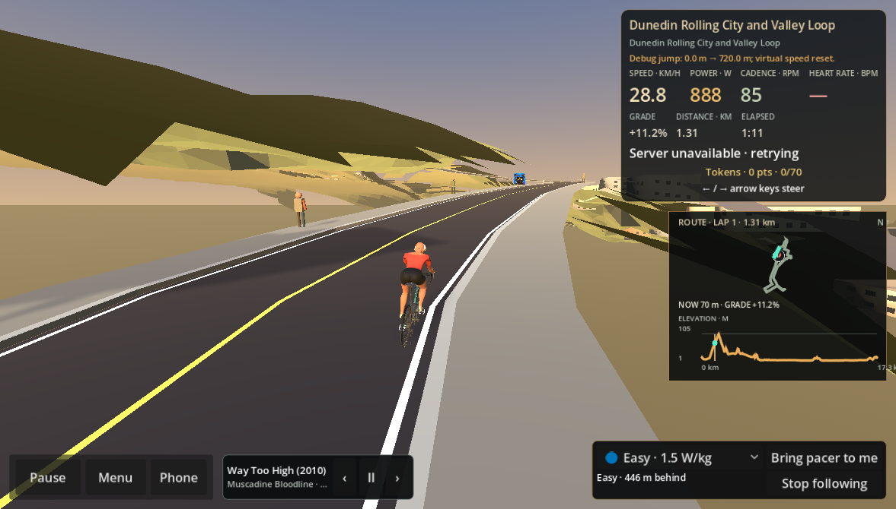 |

## Regression measurements

`RiderFinishingSceneReviewTest.tscn` sampled 72 phases across the imported
pedal cycle. Maximum palm-center distance from the hood targets was 20 mm on
each side; pelvis distance from saddle target was 96 mm; ankle origins moved
5–340 mm through the sampled cycle. These are fit/animation continuity checks,
not a substitute for visual contact or pedal-pressure validation.

The model verifier reports 947,270 triangles across 25 render meshes, versus
935,442 triangles and 24 meshes on the accepted bike-only Alpha.84 asset. This
is +1.3% triangles and one additional mesh (the merged three-surface garment
detail mesh). The final GLB grew from 36,563,576 to 36,912,212 bytes (+0.95%).
No separate GPU-time or multi-rider frame-time benchmark was run for this
rider-only change; these small geometry/draw-mesh deltas are the measured
overhead.

The rider remains stylised and the jersey/bib details are subtle. Physical
hardware and real-ride acceptance have not been performed. This PR does not
change the bike geometry, trainer, ride physics, telemetry, steering, recording,
routes or multiplayer behavior.
