# PR #163 rider and pedal production review

These are matched captures from the production `RideScreen`, rendered with
Godot 4.6.2 on the NVIDIA Quadro P620 using the OpenGL Compatibility renderer.
The desktop capture viewport was 1177 × 670. The `before` model is the PR's
pre-finish GLB from commit `0a39ad3`; the `after` model is the final rider
candidate. The same review scene and camera setup were used for both. The
RideScreen runs with its scripted fake trainer for this review; no physical
trainer, ride, or multiplayer acceptance was available.

## Helmet A/B

| View | Before | After |
| --- | --- | --- |
| Front | 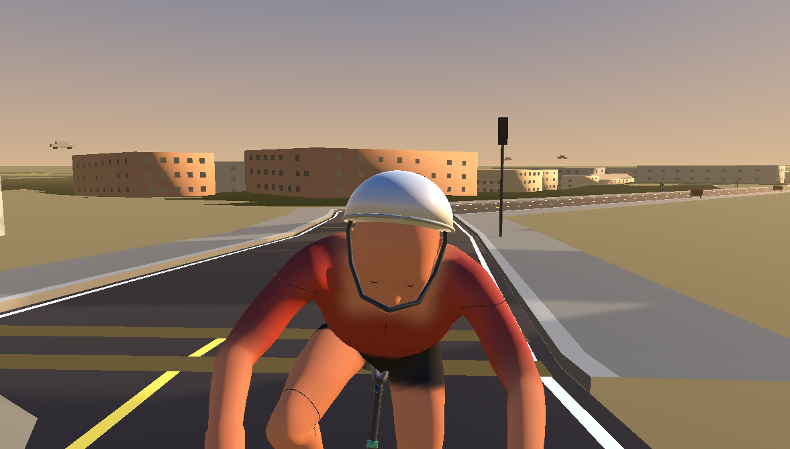 | 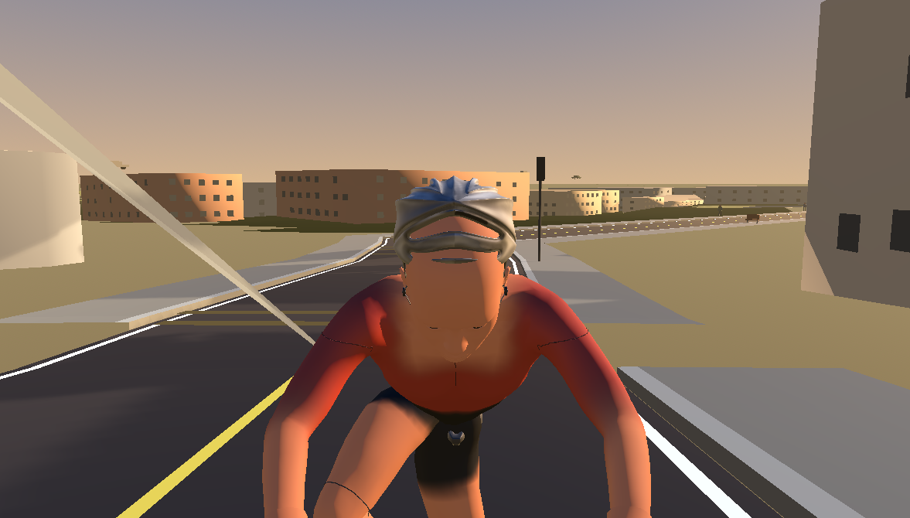 |
| Side | 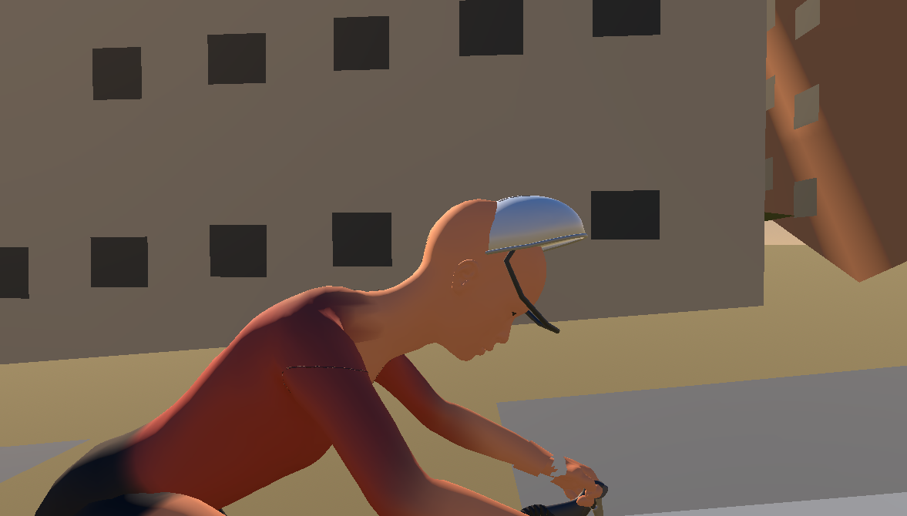 | 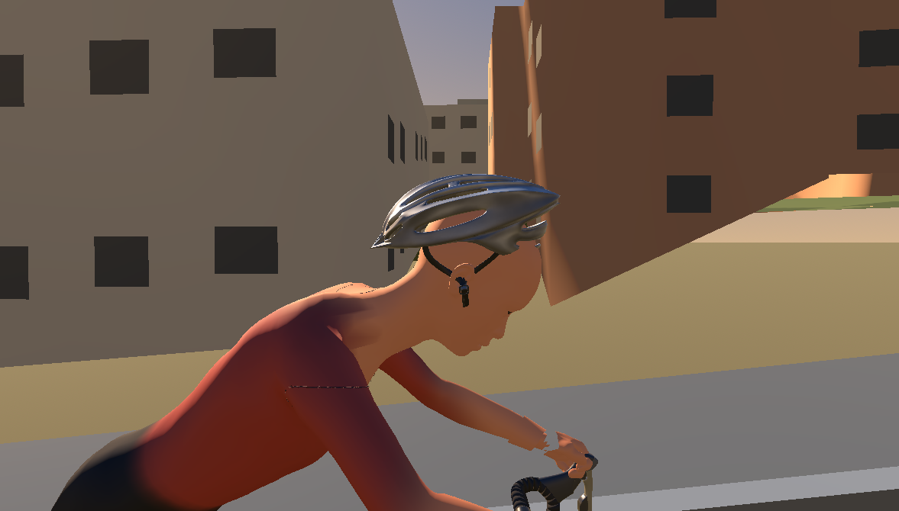 |
| Three-quarter | 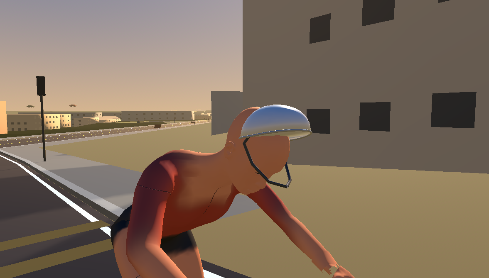 | 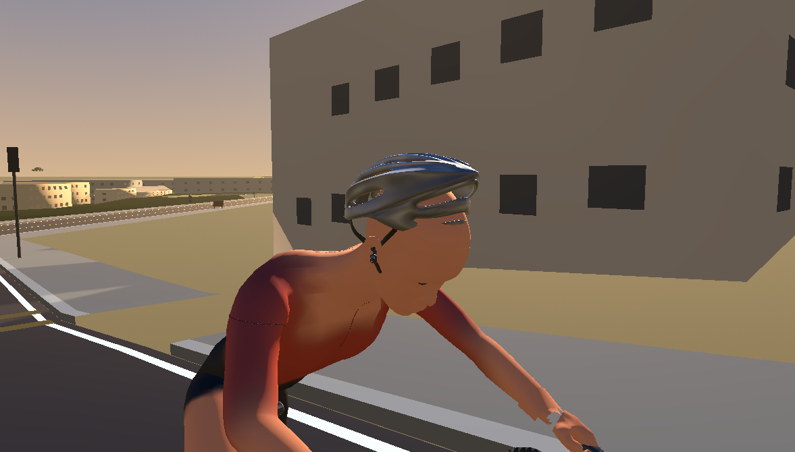 |
| Rear | 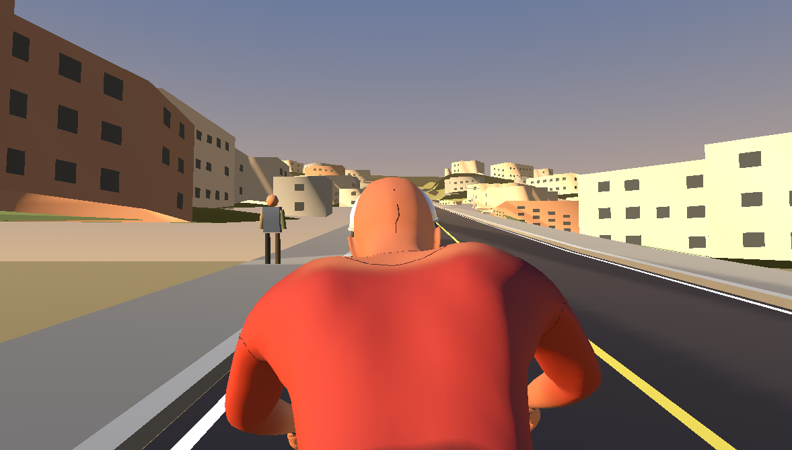 | 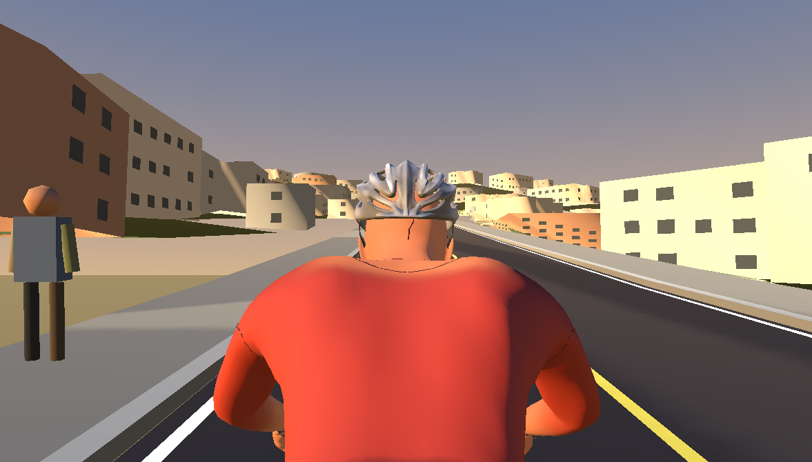 |

The after GLB uses the supplied vented road helmet with its neutralized diffuse
map, fitted shell, and head-weighted chin straps. Matching helmet-off views
confirm the head remains intact: [front](after/head-front-helmet-off.png),
[side](after/head-side-helmet-off.png),
[three-quarter](after/head-three-quarter-helmet-off.png), and
[rear](after/head-rear-helmet-off.png).

## Accepted hands and whole-rider A/B

The sculpted closed-grip hands were already accepted in `0a39ad3` and are
unchanged by the final fitting pass. These matched production views confirm
their continued hood contact:

| Hand | Before | After |
| --- | --- | --- |
| Left | 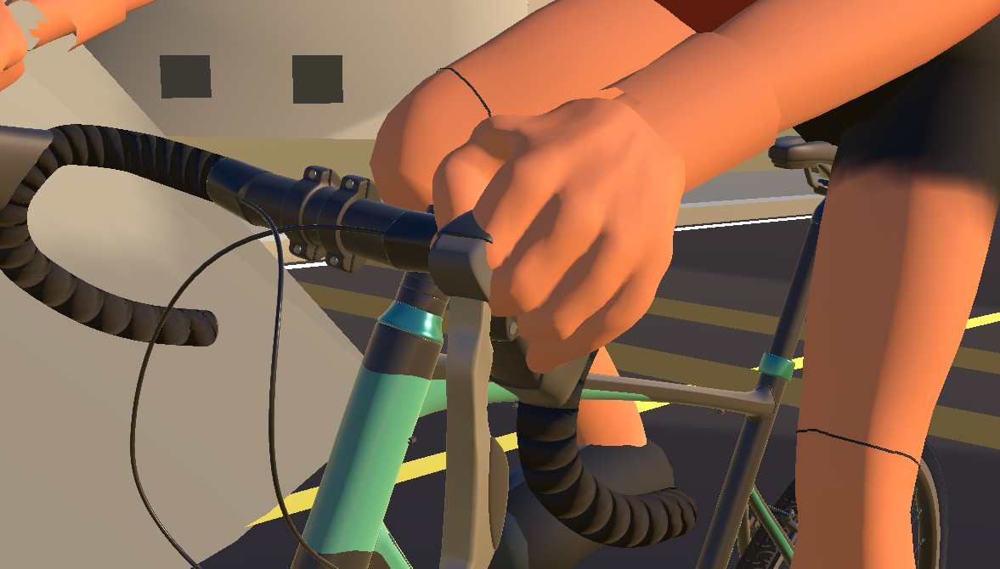 | 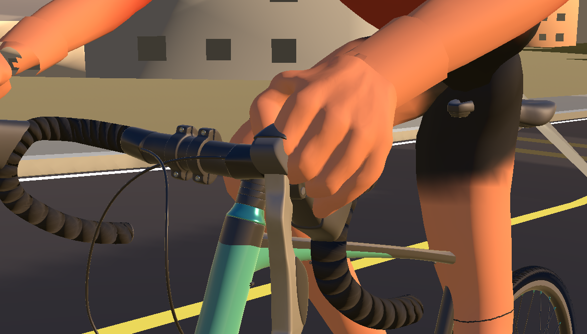 |
| Right | 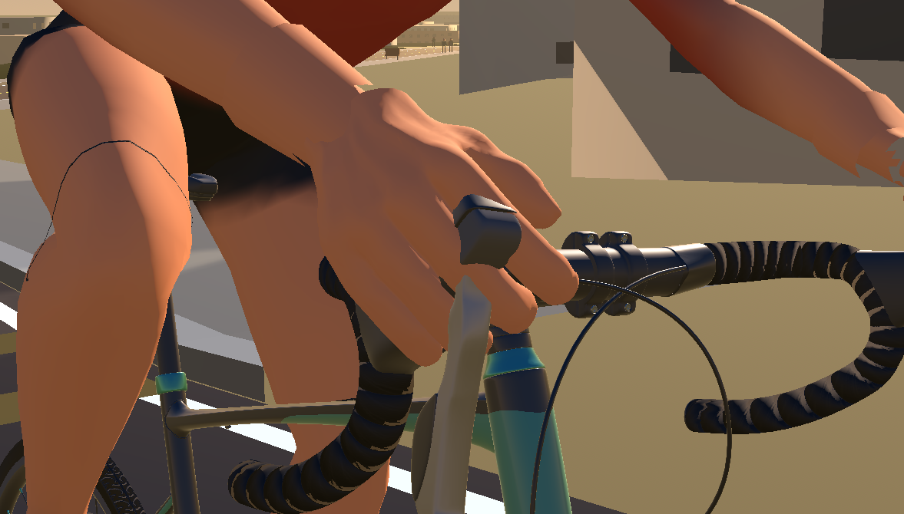 | 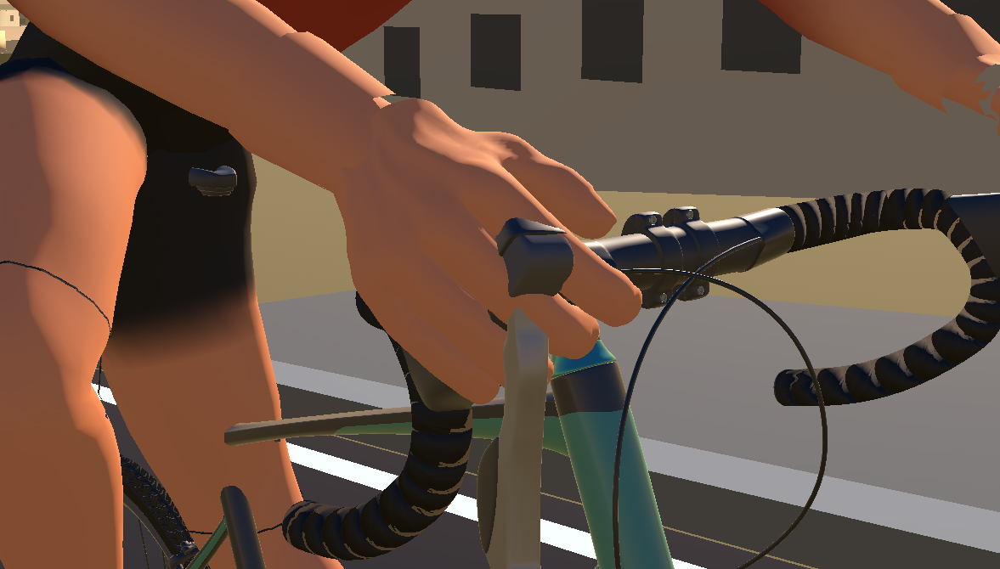 |

Elevated checks: [left before](before/hand-left-hood-elevated.png),
[left after](after/hand-left-hood-elevated.png),
[right before](before/hand-right-hood-elevated.png), and
[right after](after/hand-right-hood-elevated.png).

| Rider view | Before | After |
| --- | --- | --- |
| Side | 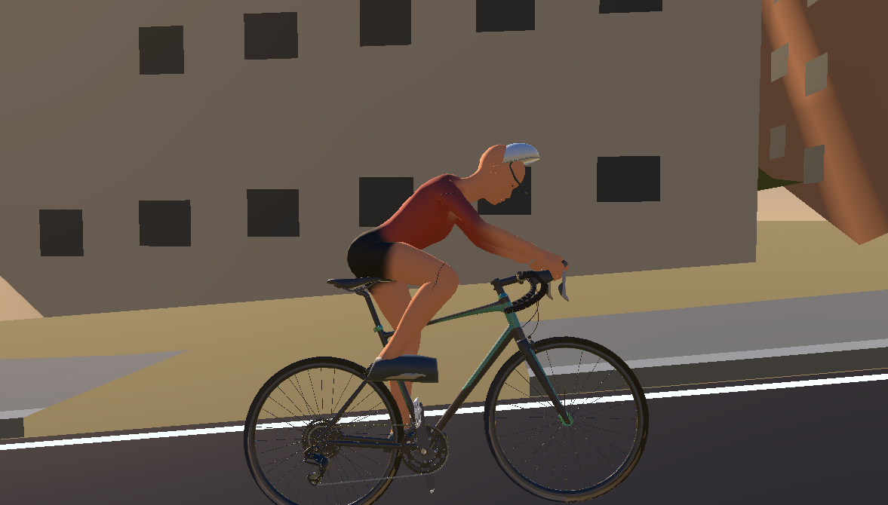 | 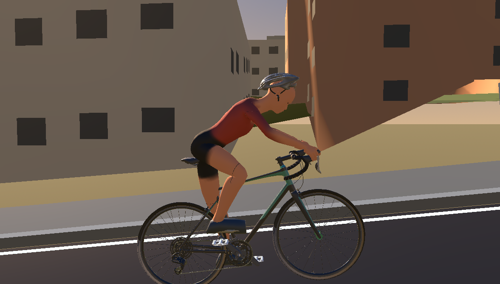 |
| Front three-quarter | 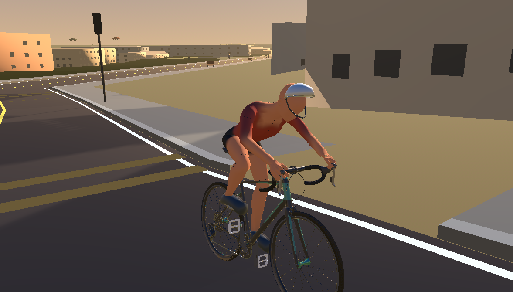 | 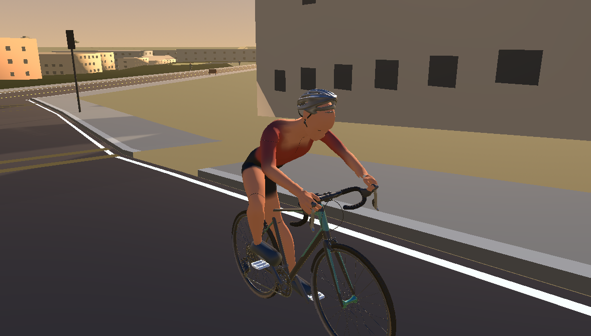 |

Normal gameplay views: [chase](after/ride-chase.png) and
[front three-quarter](after/ride-front-three-quarter.png).

## Shoes and actual moving pedals

The supplied CGTrader bicycle and crank geometry are unchanged. Each shoe is
270 mm long by 104 mm wide; each imported pedal is 114 mm long by 109 mm wide.
The shoes therefore overhang the pedal length as cycling shoes should while
remaining close to the platform width. The retarget script locates the real
platform top from the imported pedal mesh and matches the shoe's authored
forefoot/cleat vertex, not an arbitrary ankle coordinate.

Side captures show four phases of the full rotation:
[0°](after/pedals-side-phase-000.png),
[90°](after/pedals-side-phase-090.png),
[180°](after/pedals-side-phase-180.png), and
[270°](after/pedals-side-phase-270.png). Wider alignment views are
[front](after/pedals-front-alignment.png) and
[rear](after/pedals-rear-alignment.png); the direct low oblique checks are
[left shoe](after/pedals-left-shoe-contact.png) and
[right shoe](after/pedals-right-shoe-contact.png).

`retarget_pedals_163.py` checks the actual shoe and pedal meshes at all 217
source frames. The source mesh contact stays within 0.03 mm of the measured
platform surface, and the baked cycle retains 7° of ankle pitch with a maximum
42.6 mm knee step. The production RideScreen check samples 72 phases after GLB
import: maximum forefoot-marker distance to the moving pedal top is 8.94 mm
(12 mm limit). The measured ankle bone travels 9–329 mm through the cycle.

## Production motion

[16-second RideScreen motion review, H.264, 30 fps](motion-production-ride.mp4)

The 480-frame capture covers low and high cadence, steering, camera changes,
coasting, stopping, and restarting. It uses the scripted trainer; physical
hardware and networked multiplayer remain untested.

## Validation and model size

- Blender 5.2.2 reproduced the runtime GLB byte-for-byte from
  `WodraCyclist.issue159-sculpted-hands.blend`; the retargeter passed all 217
  source frames with maximum 0.03 mm shoe-to-pedal-surface error.
- `verify_road_bike_158.py`: passed; 993 mm wheelbase, grounded 700C tires,
  imported crank/pedal surfaces, bilateral cockpit contacts, 1,024,925
  triangles, and 16 render meshes.
- `RiderFinishingSceneReviewTest.tscn`: passed in the production RideScreen;
  palm-to-hood 0 mm, pelvis-to-saddle max distance 96 mm, and full-cycle
  moving-pedal contact as reported above.
- `RiderMotionReviewTest.tscn`: passed for 480 RideScreen frames at 30 fps.
- Windows solution Debug and Release builds passed. The physics, persistence,
  recording/FIT, trainer recovery, visual route, multiplayer integration and
  protocol, route builder, and Strava client/broker regression suites passed.
- Runtime GLB: 35.44 MB, 8.9% larger than the previous rider GLB due to the
  supplied helmet and baked bilateral pedal-fit animation.

The closed sculpted hands remain rigid posed grips rather than independently
articulated fingers. No physical fit or ride has been claimed.
