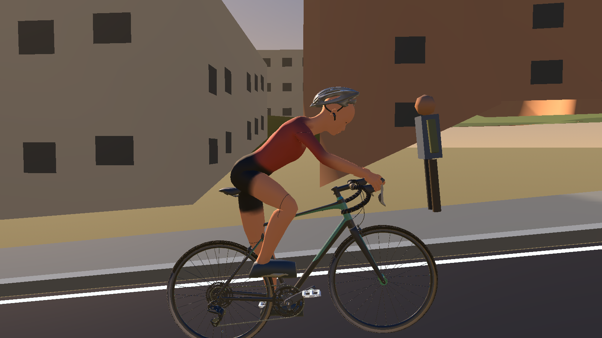
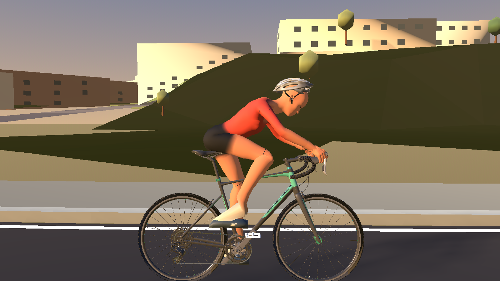

# Alpha.85 rider leg and pedalling correction

These are genuine captures from the Godot 4.6.2 production `RideScreen` on the NVIDIA Quadro P620. The after images use Dummy Trainer at 85 rpm on `Dunedin One-way: Oval to Gardens Loop`; the eight close side views are reached through `CyclistVisual`'s live cadence update. The motion clip contains 480 production frames at 30 fps (16 seconds), including low and high cadence, steering and camera changes, coasting, stopping, and restart.

## Before and after

| Alpha.85 production baseline | Corrected production model |
| --- | --- |
|  |  |

The before captures were taken from the unmodified alpha.85 GLB and runtime in an earlier RideScreen review. The route scenery differs from the corrected run; both are actual production render captures.

## Live 85 rpm crank phases

- [0 degrees](after/legs-live-side-phase-000.png)
- [45 degrees](after/legs-live-side-phase-045.png)
- [90 degrees](after/legs-live-side-phase-090.png)
- [135 degrees](after/legs-live-side-phase-135.png)
- [180 degrees](after/legs-live-side-phase-180.png)
- [225 degrees](after/legs-live-side-phase-225.png)
- [270 degrees](after/legs-live-side-phase-270.png)
- [315 degrees](after/legs-live-side-phase-315.png)

## Complete production motion capture

[Download or preview the 16 second RideScreen clip](after/ride-motion-review.mp4).

## Accepted helmet and hands

The rebuilt GLB starts from the accepted issue #163 rider source. The owner-supplied vented shell and chin straps are visible in [side](after/head-side-helmet-on.png), [front](after/head-front-helmet-on.png), [three-quarter](after/head-three-quarter-helmet-on.png), and [rear](after/head-rear-helmet-on.png) production views. The Godot import reports 39,536 helmet vertices. The editable Blender preservation check compares all 9,060 hand-weighted vertices and weights with the accepted source; the sculpted hands and fitted hood grip remain intact.

## Findings and validation

The alpha.85 lower-body rig used a five-bone chain whose helper split bones were treated as anatomical joints. Mirrored pole axes made the left knee bend behind the hip-to-ankle line, while old lower-body action curves moved the pelvis and leg anchors. The earlier fix corrected those knees and the pedal marker, but the foot bone kept the source action's near-vertical quaternion. Since the review only checked the forefoot marker, it passed while the toe axis and sole still hung down. It also rebuilt from the earlier issue #159 blend, which did not carry the accepted issue #163 supplied helmet.

The correction keeps that knee solution and the accepted rider source. It separates the ankle joint from the shoe attachment: the shin/ankle keeps its reachable leg path while an outsole-calibrated shoe bone aligns the measured toe axis with bicycle-forward and the sole with the actual pedal platform. The forefoot stays on its own moving pedal, and heel and toe outsole markers verify the rest of the sole through the full cycle. The supplied vented helmet, chin straps, sculpted hands, clothing, upper body, and bicycle are retained.

Blender full-cycle metrics: 32.5–106.9 degree knee flexion, no backward knee bend, 17.2 mm maximum knee step, 4 degree maximum shoe roll, toe and sole axes within 4 degrees of their targets, 27 mm maximum heel-plane offset, 18 mm toe-plane offset, and forefoot/pedal contact below 0.002 mm. Godot's 72-phase imported review measured toe and sole axes within 4 degrees, heel and toe outsole heights within 20/25 mm of the measured platform plane, and a 7.67 mm worst forefoot marker offset. Knee flexion remains 32.7–106.8 degrees with at most an 18.4 mm step and 0.04 mm leg-length variation. The actual phase captures and close helmet views were inspected as part of the visual review.
