# Alpha.85 rider leg and pedalling correction

These are genuine captures from the Godot 4.6.2 production `RideScreen` on the NVIDIA Quadro P620. The after images use Dummy Trainer at 85 rpm on `Dunedin One-way: Oval to Gardens Loop`. The eight close side views are triggered by the live `CyclistVisual` cadence update; the harness logs the observed live crossing, then freezes the imported rider at the exact labeled clip phase while the frame renders. This keeps GPU latency from making a labeled evidence image show a later pedal phase. The motion clip contains 480 production frames at 30 fps (16 seconds), including low and high cadence, steering and camera changes, coasting, stopping, and restart.

## Before and after

| Alpha.85 production baseline | Corrected production model |
| --- | --- |
|  |  |

The before captures were taken from the unmodified alpha.85 GLB and runtime in an earlier RideScreen review. The route scenery differs from the corrected run; both are actual production render captures.

## Live 85 rpm crank phases

- [0 degrees](after/legs-live-side-phase-000.png)
- [45 degrees](after/legs-live-side-phase-045.png)
- [90 degrees](after/legs-live-side-phase-090.png)
- [135 degrees](after/legs-live-side-phase-135.png)
- [180 degrees](after/legs-live-side-phase-180.png)
- [225 degrees](after/legs-live-side-phase-225.png)
- [270 degrees](after/legs-live-side-phase-270.png)
- [315 degrees](after/legs-live-side-phase-315.png)

## Clear full-rider side views

These unobstructed side views use the same imported rider and bicycle in the
production RideScreen review scene, with the baked rider clip and pedals held at
the exact labeled crank phase. The live Dummy Trainer 85 rpm phase captures and
motion clip below exercise the actual cadence update path; these stills make it
possible to compare the accepted forward-facing helmet, knee path, and both
shoes without the HUD covering them.

| 0 degrees | 90 degrees |
| --- | --- |
| 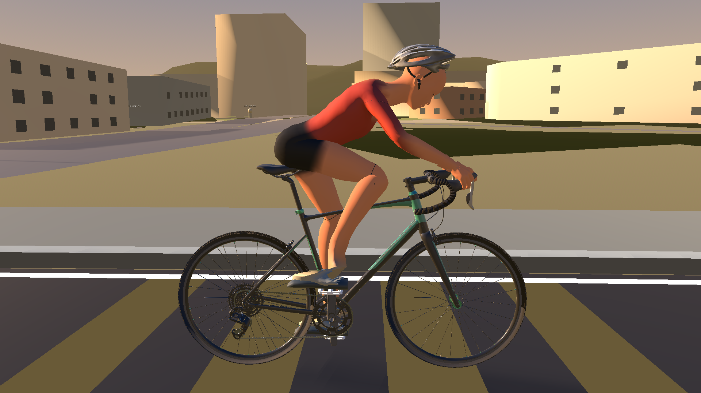 | 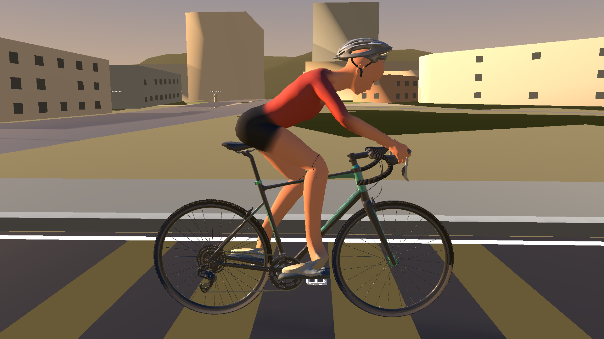 |

| 180 degrees | 270 degrees |
| --- | --- |
| 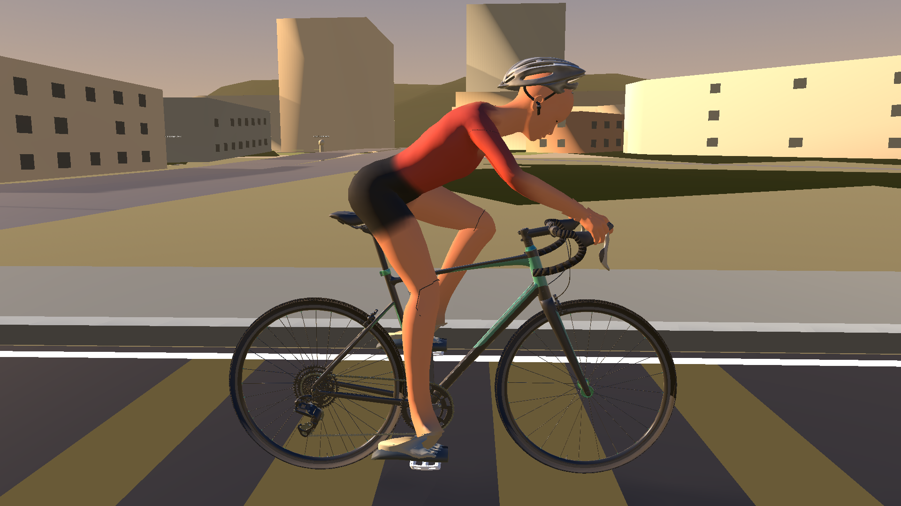 | 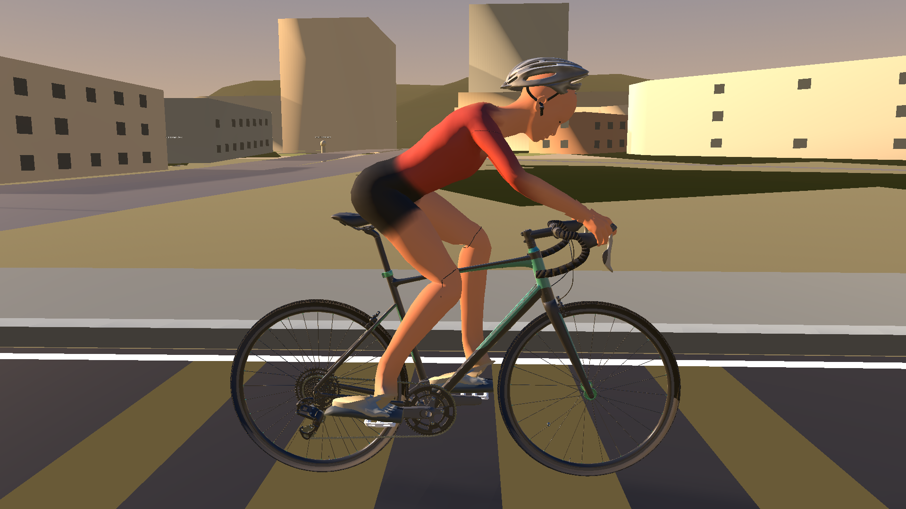 |

## Helmet orientation: rejected PR capture and corrected model

The four `before/helmet-backwards-pr164/` views are the rejected production
captures from the earlier PR revision. The `after/` views were freshly
captured from the corrected exported GLB in Godot 4.6.2 RideScreen. In each
side view, the rider's face points right toward the front wheel. The supplied
helmet's short brow lip is now over the forehead at the right; its long tapered
tail and rear-retention cradle sit behind the skull at the left. The chin
straps remain attached below the jaw.

| View | Rejected PR #164 | Corrected GLB |
| --- | --- | --- |
| Side | 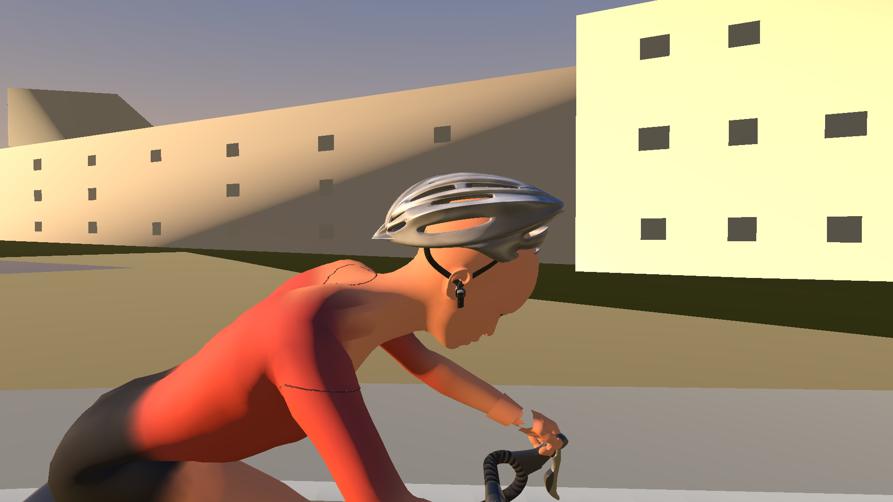 | 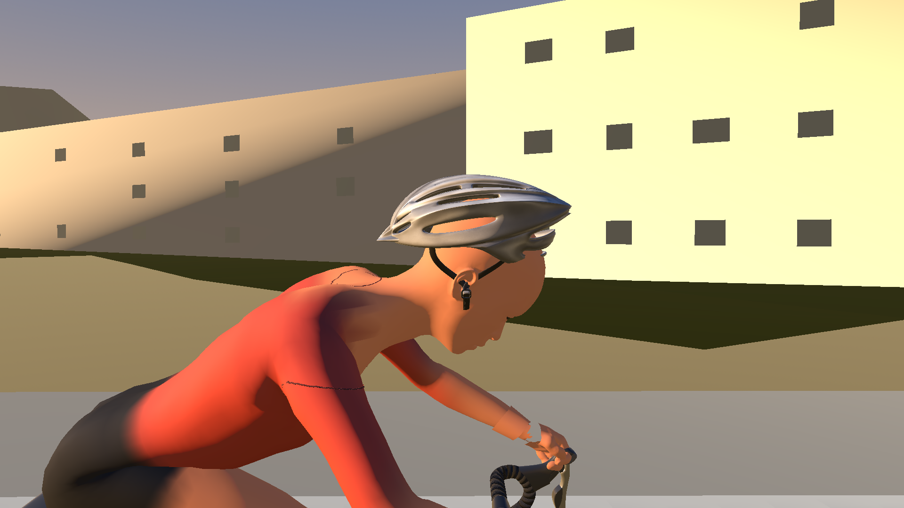 |
| Front | 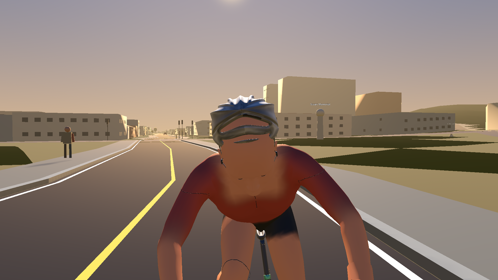 | 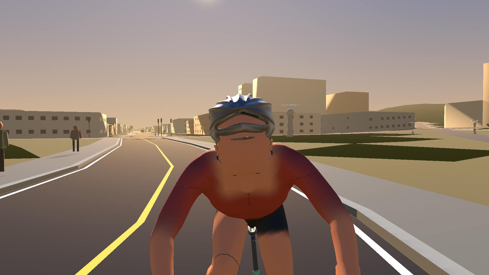 |
| Three-quarter | 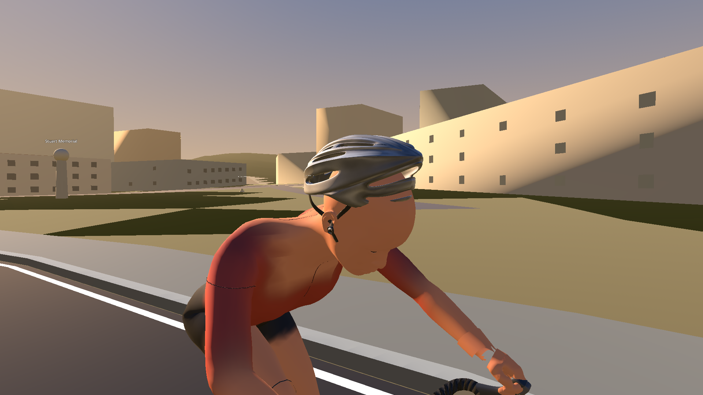 | 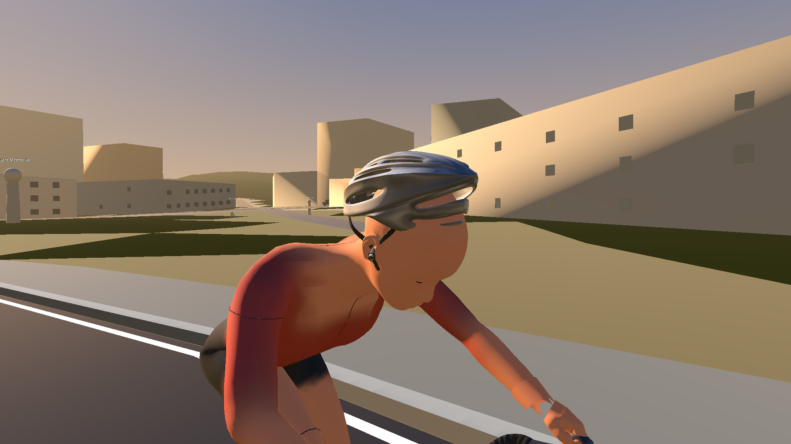 |
| Rear |  | 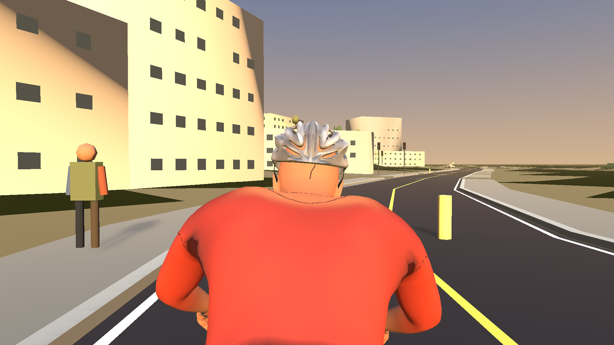 |

The marked side-camera capture at
[`after/head-side-helmet-physical-features.png`](after/head-side-helmet-physical-features.png)
shows the independently source-identified brow lip in red, eye center in
green, and rear tail in blue. In the actual RideScreen projection they appear
at x=1,151, x=1,066, and x=861 pixels respectively: rear tail, eyes, front lip.
That screen-space order is also a regression assertion.

## Complete production motion capture

[Download or preview the 16 second RideScreen clip](after/ride-motion-review.mp4).

## Corrected supplied helmet and hands

The Blender correction starts from the accepted issue #163 rider and owner-
supplied vented helmet OBJ. It imports the OBJ by itself in its physical Z-up
frame, then inspects the projecting brow lip, shell taper, ventilation, and
rear-retention cradle from the side, front, and rear. The short brow lip is at
source negative Y; the long aero tail and retention cradle are at positive Y.
The rider's actual forehead, eyes, and nose independently face the front wheel.
These neutral-material standalone source views show the identification:
[front](helmet-source-inspection/front-view-from-minusY.png),
[rear](helmet-source-inspection/rear-view-from-plusY.png), and both side
directions ([from +X](helmet-source-inspection/side-view-from-plusX.png),
[from -X](helmet-source-inspection/side-view-from-minusX.png)).

The failing PR asset put the source-verified brow lip 196 mm behind the eyes
and the rear tail 107 mm ahead. The corrected helmet mesh turns 180 degrees
around the measured head-up axis: the brow lip is 143 mm ahead of the eyes, the
rear tail 160 mm behind, and the physical front-to-rear axis has a 0.991 dot
with bicycle-forward in Blender. The correspondence from source OBJ vertices to
the fitted helmet is below 0.0003 mm. In Godot, the markers remain within 4 mm
of the skinned helmet mesh; the front lip is 62 mm ahead of the eyes and the
rear tail 153 mm behind, with a 0.956 physical-axis/bike-forward dot. The real
RideScreen side camera projects rear tail < eyes < brow lip, and a deliberately
reversed 180-degree mesh control fails both the Blender and Godot regressions.

The earlier check passed because it chose a central component as rear-
retention hardware using only component size and position, then derived the
front/rear shell markers from the rider's face direction. That made the
reference markers agree with the face even when the shell was backward. The
new check uses feature vertices mapped from the separately inspected OBJ and
validates them against the rendered mesh, actual eyes/nose, bike forward axis,
and side-camera projection. No leg, shoe, hand, bicycle, clothing, torso, or
posture geometry changed in this helmet-only correction; the deterministic
snapshot hash for non-helmet geometry, transforms, bones, and action curves is
unchanged. The supplied vented shell and chin straps remain intact, and the
accepted sculpted hands still match all 9,060 source hand-weighted vertices and
weights.

## Findings and validation

The alpha.85 lower-body rig used a five-bone chain whose helper split bones were treated as anatomical joints. Mirrored pole axes made the left knee bend behind the hip-to-ankle line, while old lower-body action curves moved the pelvis and leg anchors. The earlier fix corrected those knees and the pedal marker, but retained the source foot quaternion on the ankle/foot bone while a separate calibrated shoe bone carried the forefoot marker. In Godot, that left the actual foot-bone axis 36.5 degrees away from the shoe's heel-to-toe axis and its sole normal 155.5 degrees from the pedal normal. The old checks measured the shoe bone and forefoot marker, not the ankle/foot bone against the imported shoe, so the one-point contact passed while the foot still hung from the shin like a boot. The earlier rebuild also used the issue #159 blend, which did not carry the accepted issue #163 supplied helmet.

The correction keeps that knee solution and the accepted issue #163 rider source. It derives each shoe's heel-to-toe and outsole-up axes from the actual mesh and the pedal normal from imported pedal geometry. The ankle/foot and independently skinned shoe now share that measured frame; the toes follow bicycle-forward and the sole tracks the pedal platform with 4 degrees of phase-linked ankle pitch. The forefoot stays on its own moving pedal, while separate heel and toe markers check the rest of the sole through the full cycle. The source shoe's 128 mm thickness is scaled to 58.9 mm (58.88 mm in Godot's imported mesh bounds). The supplied vented helmet and chin straps, sculpted hands, clothing, upper body, and bicycle are retained.

Blender full-cycle metrics: 32.5–106.9 degree knee flexion, no backward knee bend, 17.2 mm maximum knee step, 4 degree maximum shoe pitch, foot-to-shoe axis error below 0.03 degrees, foot-to-pedal-normal error 4 degrees, 27 mm maximum heel-plane offset, 18 mm toe-plane offset, and forefoot/pedal contact below 0.002 mm. Godot's 72-phase imported review measures foot-to-shoe axis error at 0 degrees, foot-to-pedal-normal error at 4 degrees, toe and sole axes within 4 degrees of their targets, heel and toe outsole heights within 20/25 mm of the measured platform plane, and a 7.67 mm worst forefoot marker offset. Heel and toe remain above the platform plane throughout the cycle. Knee flexion remains 32.7–106.8 degrees with at most an 18.4 mm step and 0.05 mm leg-length variation. Live 85 rpm phase captures were reached through the production cadence update path on the requested route; all eight were visually inspected along with the side contact views, the corrected vented helmet and chin straps, and the rebuilt 480-frame, 16-second motion clip. The Godot importer reports 39,536 helmet vertices, and the Blender preservation check confirms unchanged helmet topology and all 9,060 hand-weighted vertex positions and weights.
