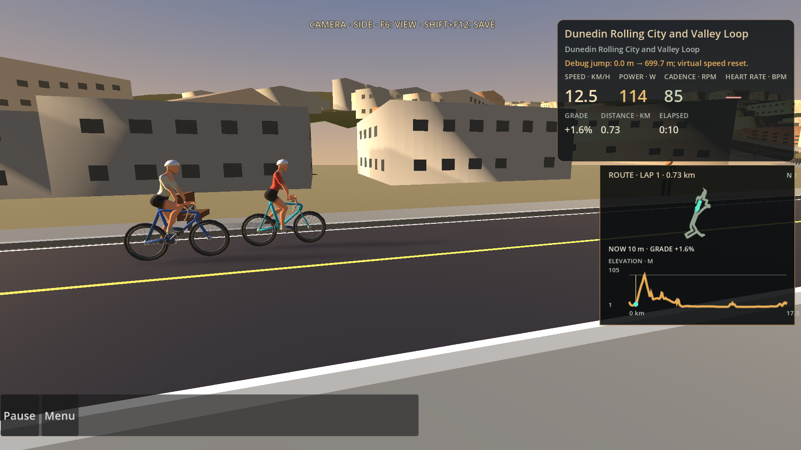
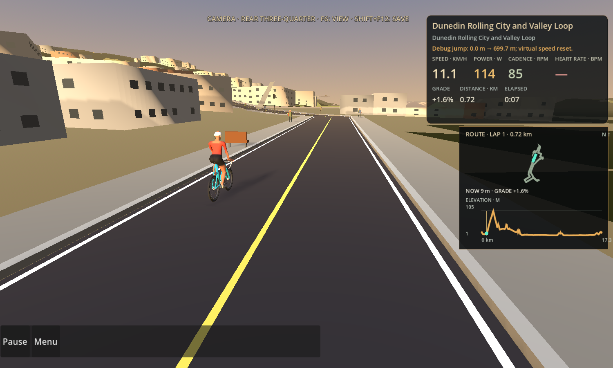
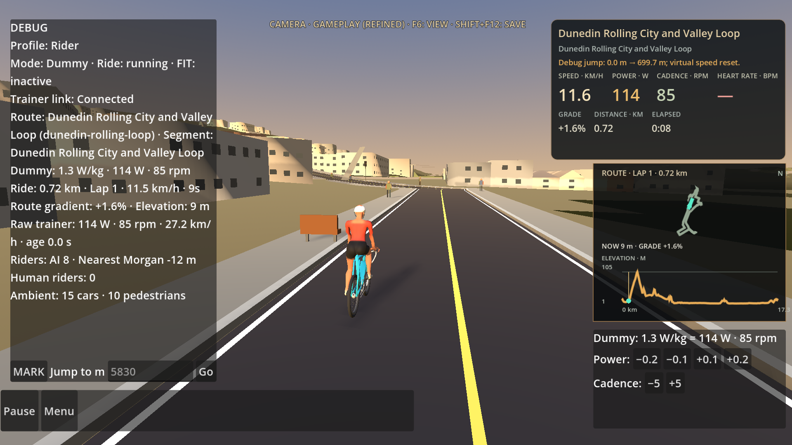

# Issue #93 camera and pacing review

These are controlled production `RideScreen` captures and buffered measurements from the local review environment. The CSV contains numeric ride/camera/frame samples only.

## Before and after

`before-dynamic-world-aabb.csv` and `before-summary.txt` were captured before the stable-bounds camera change, with the same 9 imported riders, route, window size, cadence, renderer and test harness. The pre-fix world AABB depth varied by 0.2403 m. The fitted camera's desired world Z offset relative to the rider varied by 0.11835 m in that sample.

`after-ride-jitter-realtime.csv` and `after-summary.txt` use the fixed camera. The actual world AABB still varies (depth 0.2397 m), but the cached rider-root-local bounds passed with zero variation. Desired camera Z offset range was 0.06354 m in the comparable animated-baseline segment; X/Y ranges were 0.10727/0.01056 m. Camera-to-rider distance range was 0.05847 m.

The pre-fix and post-fix camera offset samples are close runs, not a deterministic replay of the unavailable owner recording. Do not interpret the local frame-time samples as proof that the owner's visual judder is resolved.

## Runtime context and frame timing

- Godot 4.6.2, OpenGL Compatibility, Quadro P620, Intel i7-9700, 1920×1080 window, 59.973 Hz display, VSync enabled.
- Production Dunedin One-way RideScreen with 9 imported cyclists and debug HUD.
- Animated-baseline: 722 frames, p50/p95/p99/max 16.67/16.67/16.67/26.18 ms, 1 frame above 17 ms, zero frames at or above 33.33 ms.
- Skeletal-sampling-disabled comparison: 720 frames, 16.67/16.67/16.67/16.67 ms, zero frames at or above 33.33 ms.
- Restart/steer/coast: 720 frames, 16.67/16.67/16.67/16.67 ms, zero frames at or above 33.33 ms.
- A separate settled 180-frame camera sample measured 0.010 m distance range and 0.064 m largest one-frame camera position step.

## Screenshots

All are from the production `RideScreen` with HUD, in normal route rendering, after dismissing the debug-jump confirmation:

No video recording tool was installed in this environment, so the real-time results are provided as buffered per-frame CSV instead of a video clip. The owner's 2026-10-21 MP4 and diagnostic ZIP were not mounted in this session.
