# Alpha.90 garment production evidence

These unannotated stills were captured from the production `RideScreen.tscn` by
`RiderFinishingSceneReviewTest.tscn` with Godot 4.6.2 on the Quadro P620 at
1920 × 1080. The full capture used the real imported cyclist and production
camera/animation paths; the files here are selected without cropping or markup.

The final scene review reported `PASS`. It checks the imported skinned meshes,
selected jersey color, full crank-cycle shoe/pedal contact, helmet head following,
and the existing rider pose. Eight shorts views cover 0° through 315° in 45° steps.
The evidence includes teal, navy/red, and white jersey selections.

The garment builder reports 5,109 jersey fabric triangles, 200 collar triangles,
160 sleeve-hem triangles, 66 zipper triangles, 1,718 bib-short fabric triangles,
and 176 gripper triangles: 7,429 added triangles across six garment surfaces per
rider. This is a geometry/surface-count comparison; no frame-time benchmark was
captured. Garments use two additional skinned mesh instances and the existing
skeleton and Human mesh.

The headless and rendered Godot review processes emit renderer RID leak diagnostics
when the test harness exits. The scene itself reports `PASS`; the log contains no
script errors or garment initialization errors.

## Jersey

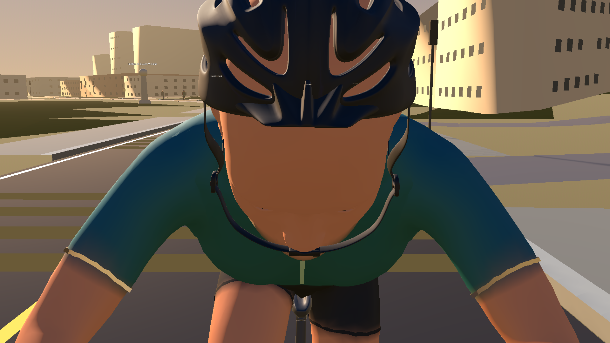
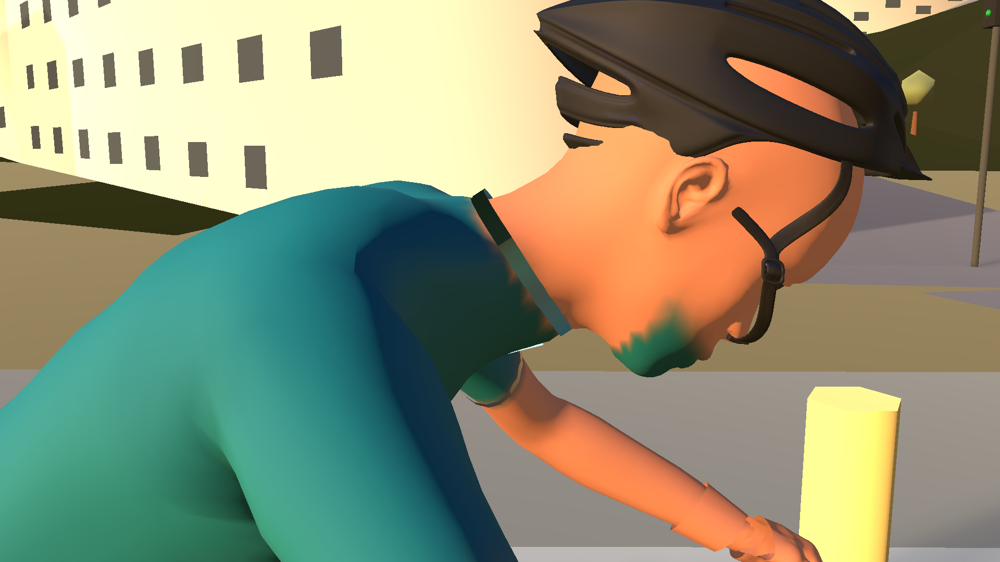
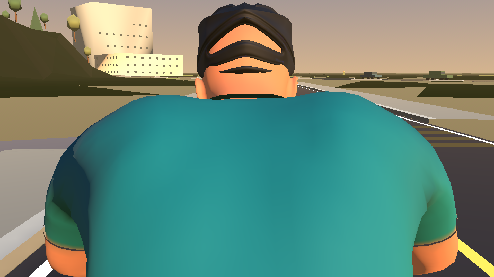
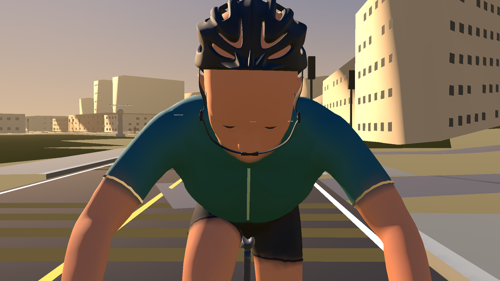
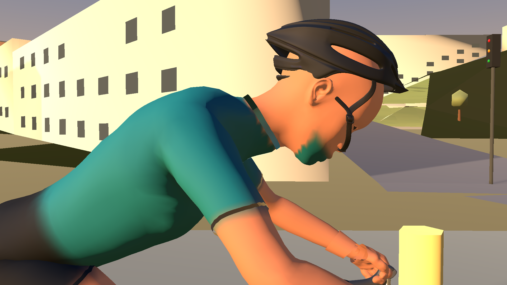
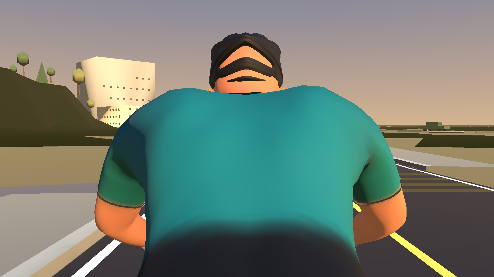
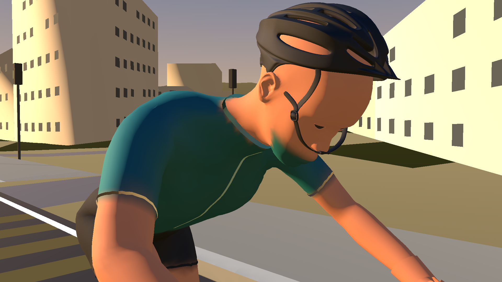

## Bib shorts

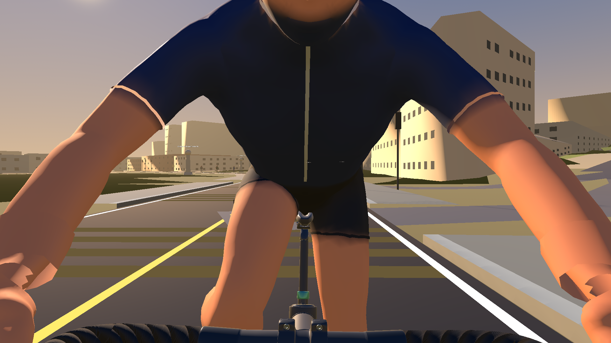
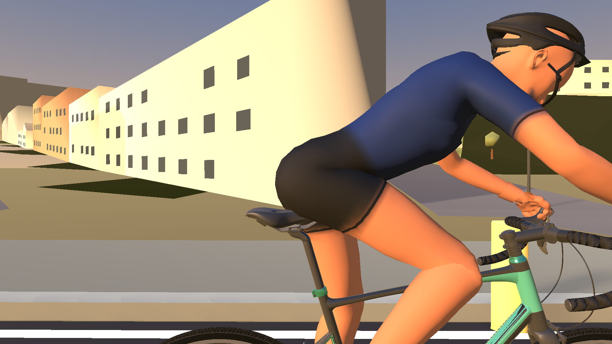
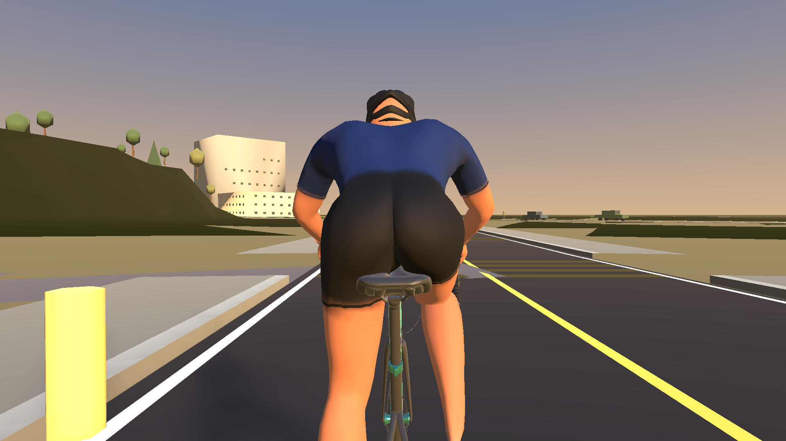
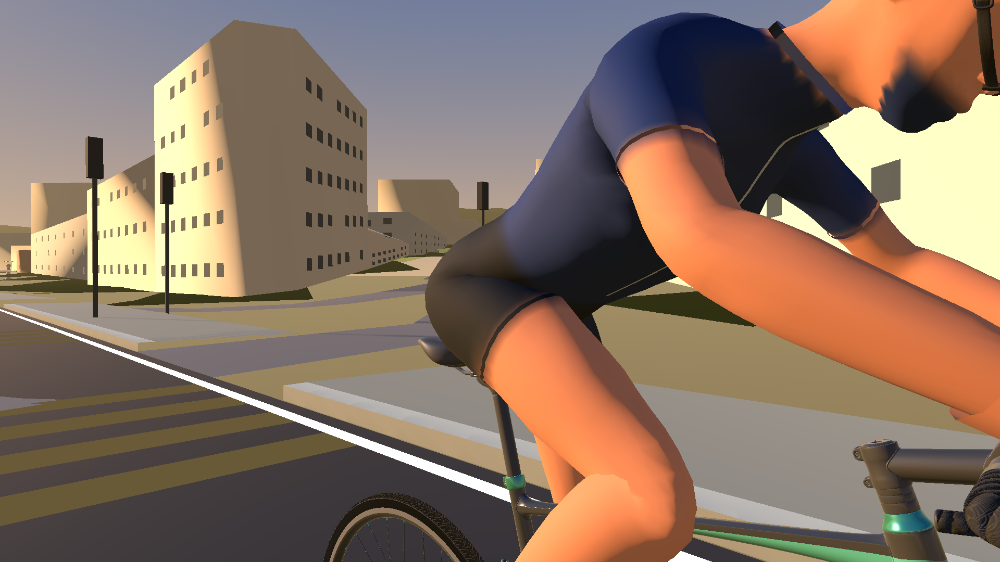

The eight `garment-shorts-side-phase-*.png` images show the fitted hems and fabric
through a complete crank cycle.

## Complete rider

The `fit-rider-*.png` views show front, side, rear, three-quarter, and jersey
color selections. `rider-side-full-phase-*.png` shows the full rider at 0°, 90°,
180°, and 270° of the production pedal animation.

Owner visual acceptance remains outstanding; these files are for review.
