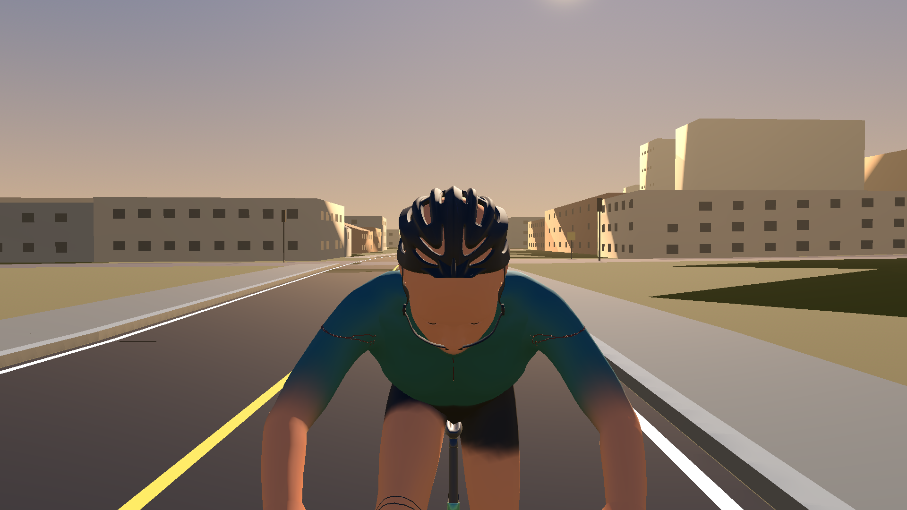
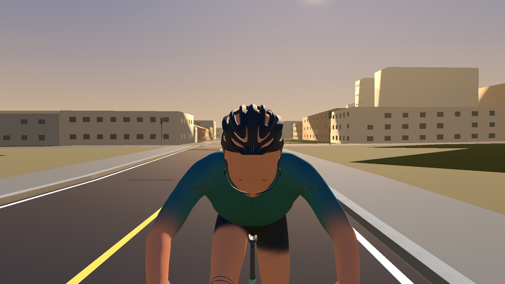
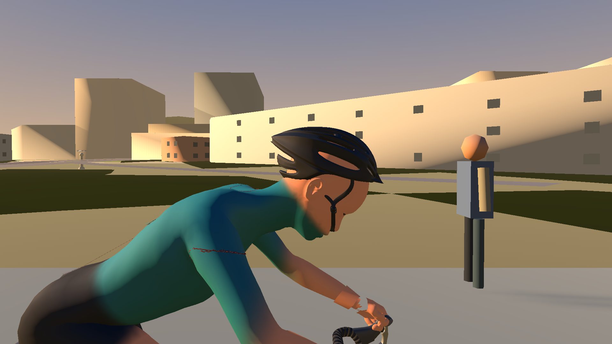
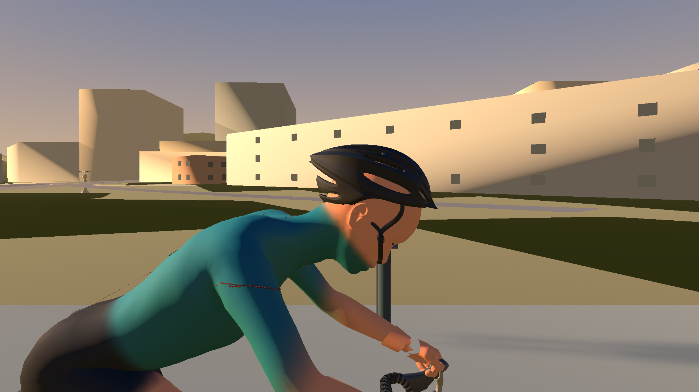
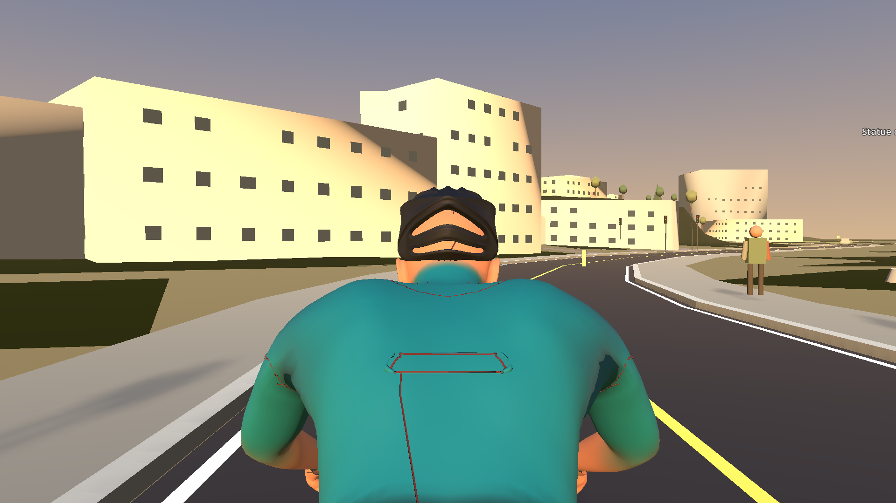
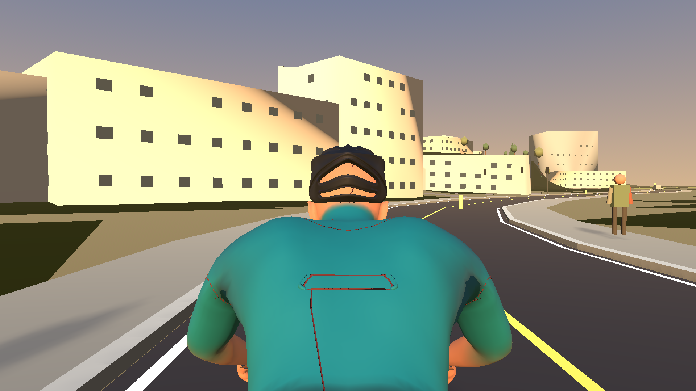
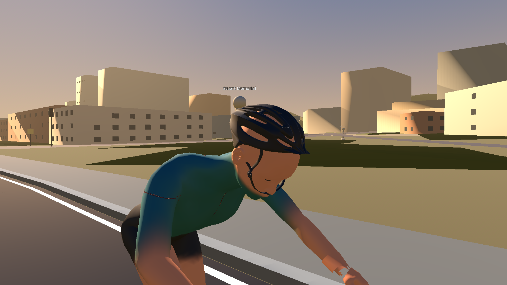

# Alpha.90 helmet fit investigation

These full resolution views were captured by Godot 4.6.2 from the production
RideScreen review scene on the current alpha.89 rider baseline. The run used the
Dummy Trainer at 85 rpm and 1920x1080 output. Both sets use the same review
harness and its front, side, rear, and three-quarter head cameras.

## Production views

| View | Alpha.89 reference | Restored baseline validation |
|---|---|---|
| Front |  |  |
| Side |  |  |
| Rear |  |  |
| Three-quarter |  |  |

The alpha.90 two-landmark fitter was not retained. The restored views use the
existing alpha.89 attachment, including its 12 degree forward pitch, supplied
helmet mesh, texture, straps, and color options. The rider and helmet appearance
are the same in the two capture sets; the second run validates the restored
baseline after the failed fitting experiment was stashed.

## What caused the 132 mm residual

The residual did not measure shell clearance against the actual rear of the
skull. In the failed experiment, the fitter formed `faceForward` from the vector
between the eye centroid and the mean of head-bone-weighted vertices. It then
called the extreme vertices in a narrow, centerline strip above the eyes
“forehead” and “occiput.” Those points are not independent anatomical landmarks
and change with the sampled pose. The reported residual was the distance from
the shell's rear-tail marker to that strip's inferred rear target after moving
the brow to the strip's inferred front target. It was therefore a pose-dependent
landmark-selection error, not a measured 132 mm gap between the helmet and
occiput.

The attachment, skin, and rigid-shell transforms were inspected in the same
Godot world frame. The rider, skeleton, Human mesh, head-bone attachment, helmet
pose, assembly, and mesh transforms all retained unit model scale; the helmet
root transform is identity. The brow and rear-tail markers remain physically
forward and rearward respectively. The failure was the target-point selection,
not a missing scale conversion or a reversed helmet.

## Geometry survey

The full weighted head-vertex envelope in the production pose spans 220 mm along
bicycle-forward. The supplied rigid assembly vertex envelope spans 262 mm in
that direction: approximately 31 mm beyond the front and 11 mm beyond the rear
of the measured head envelope. Vertically, the helmet's highest sampled vertex
is 17 mm above the highest weighted head vertex. The side-view point-cloud
survey found the front forehead region 7 mm from the nearest shell vertex and
the left/right temple samples about 9 mm away. The narrow experiment-only
“occiput” sample was 46 mm from the nearest helmet vertex; visual inspection
shows that this sample is not the physical rear-shell contact point and should
not be used as the fit datum. These are nearest-vertex measurements, not signed
surface clearances; the production renders are the acceptance evidence.

The source shell measures approximately 178 x 274 x 150 mm after the supplied
fit/export transform. Its longitudinal and crown envelope can fit the rider
without distorting the supplied mesh. The rendered front, side, rear, and
three-quarter views show the shell over the crown and upper rear skull, the brow
above the forehead, and the straps seated below the jaw. No shell or strap
clipping is visible in these production views. The alpha.89 fit is retained;
the failed two-point target was discarded instead of driving a compensating
translation or pitch.

## Reproduction

The Godot console outputs are saved as `before-godot.log` and `after-godot.log`;
the complete world-space survey is in `godot-helmet-survey.log`. Both runs used
task-isolated Godot user data under `%TEMP%\Wodra-alpha90-userdata`.

The failed jersey/shorts/helmet experiment remains preserved in the local Git
stash named `alpha90 failed visual review preserved before helmet-only
investigation` (`stash@{0}`). No PR, merge, or release was created.
