# Helmet forward-position comparison and selected production fit

Candidate B (+10 mm forward) has been selected by the owner and is now applied to the production helmet attachment. The comparison captures remain here for review history; the selected production capture and live pedal-cycle evidence are below.

## Selected production result

Godot 4.6.2 rendered the production RideScreen with the selected offset at 1920×1080. The supplied helmet shell, straps, scale, orientation, and 12° forward pitch are unchanged. The production attachment now adds 10 mm along the live bicycle-forward axis in the head-attachment frame, so it continues to follow head-bone translation and animation. No automatic fit or landmark alignment was added.

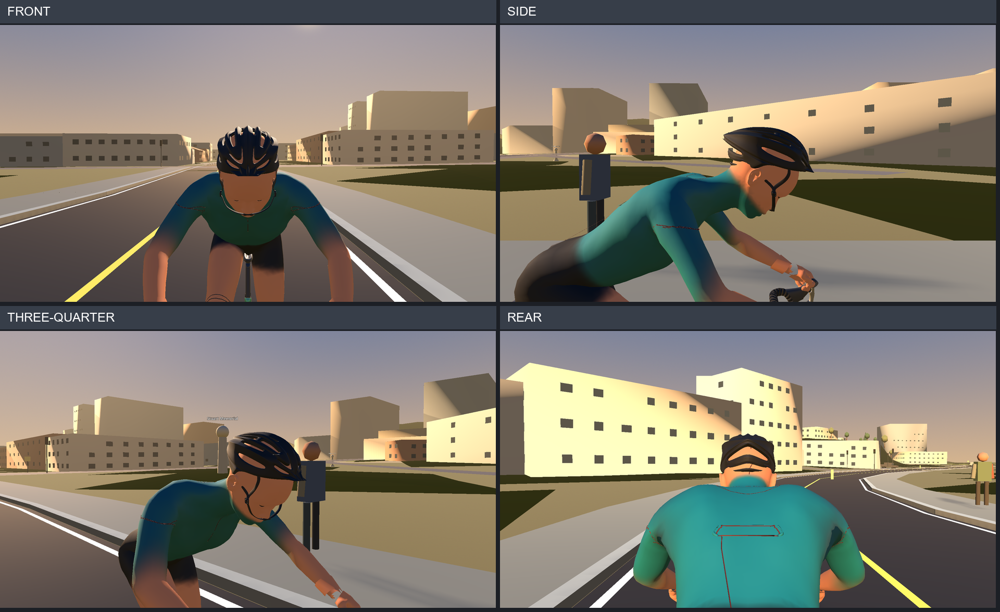

[Live production pedal-cycle side views at eight phases](production-selected-B/production-pedal-cycle-sheet.png)

Unannotated, full-resolution production views are in [`production-selected-B`](production-selected-B/). Eight 1920×1080 live RideScreen phase captures and the Godot console log are included. The existing production review completed with `PASS: imported GLB in RideScreen`; its full-cycle checks report both legs' shoe-to-pedal contact and bilateral hand-to-hood contacts while the helmet remains head-attached. Full-cycle rider bounds/animation checks ran without helmet detachment. The log and images are evidence of this run, not a substitute for the owner-approved selection.

## Original four-position comparison

Four unannotated production RideScreen captures per candidate were rendered with Godot 4.6.2 at 1920×1080. The only comparison difference was a review-scene translation along the live bicycle-forward vector, calculated in Godot as `(frontWheel.GlobalPosition - rearWheel.GlobalPosition).Normalized()`. Pitch stayed at 12°; shell, straps, scale, orientation, pose, and relative camera settings were held constant. No vertical, rotational, or scale adjustments were combined. These comparison-only controls were removed after selection.

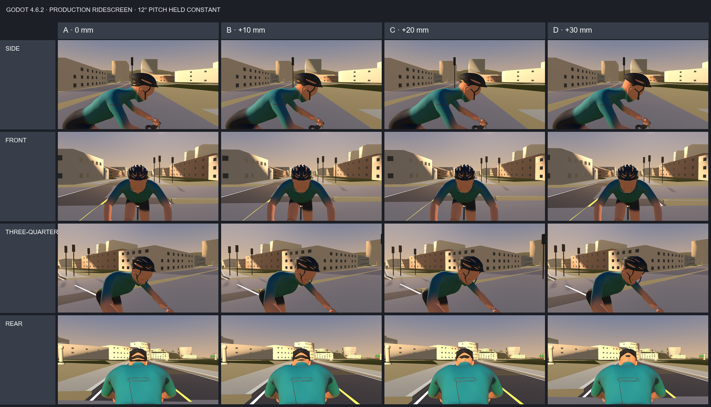

[Close side comparison](comparison-side-close.png)

| Candidate | Forward offset | Front | Side | Three-quarter | Rear |
|---|---:|---|---|---|---|
| A | 0 mm, alpha.89 position | 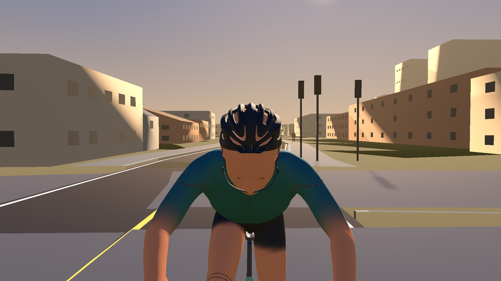 | 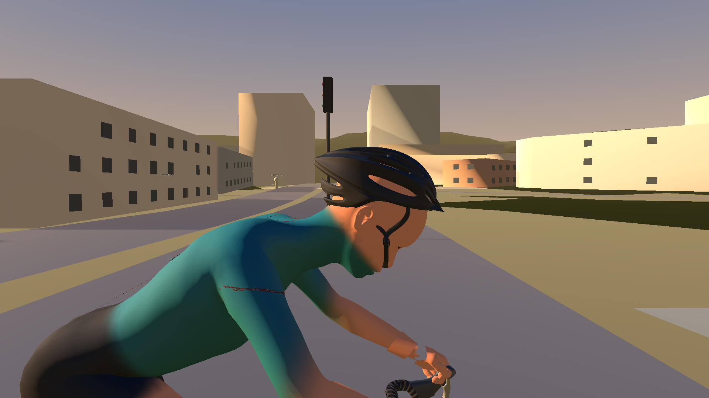 | 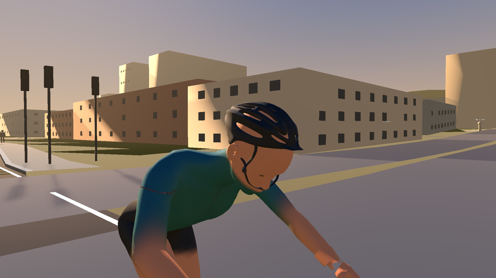 | 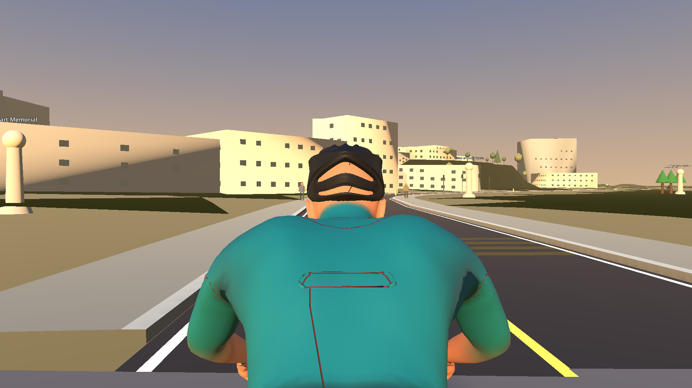 |
| B | +10 mm, selected | 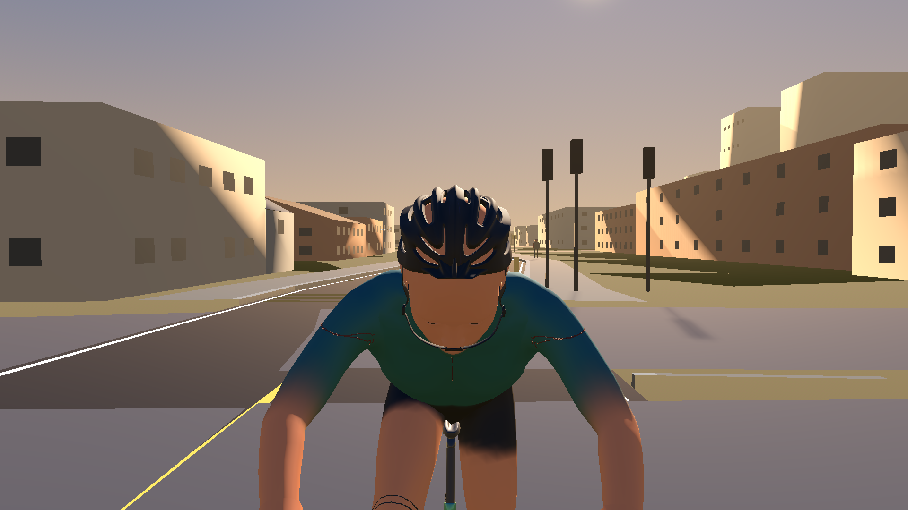 | 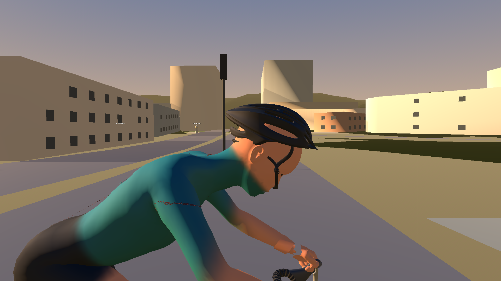 | 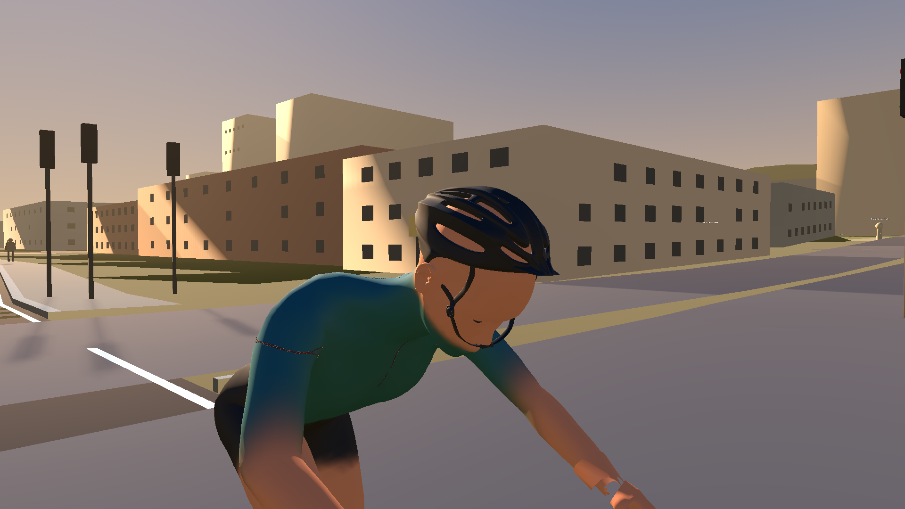 | 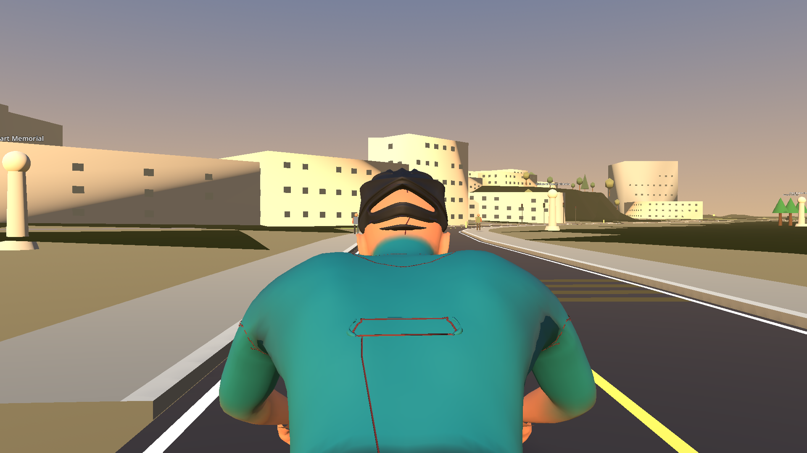 |
| C | +20 mm | 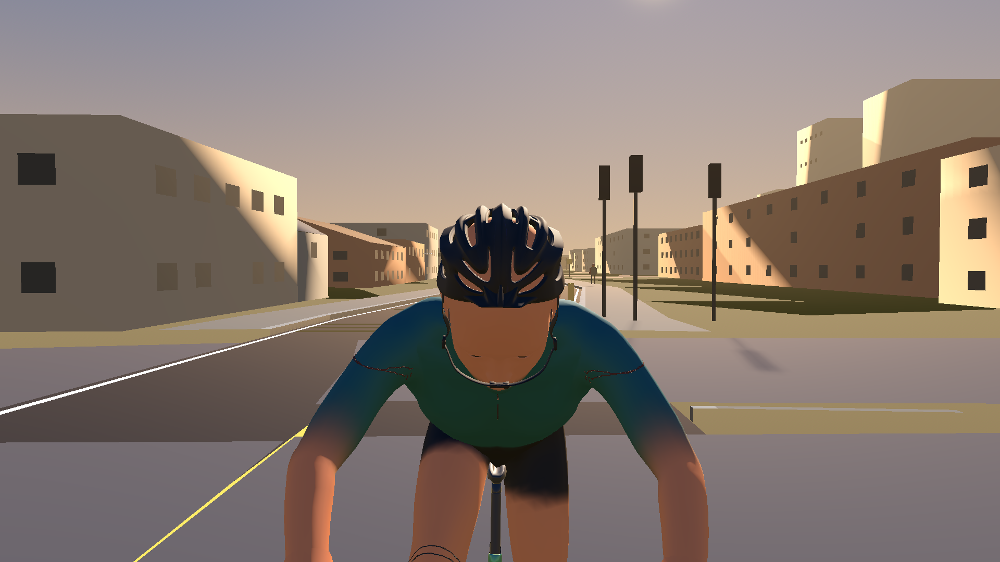 | 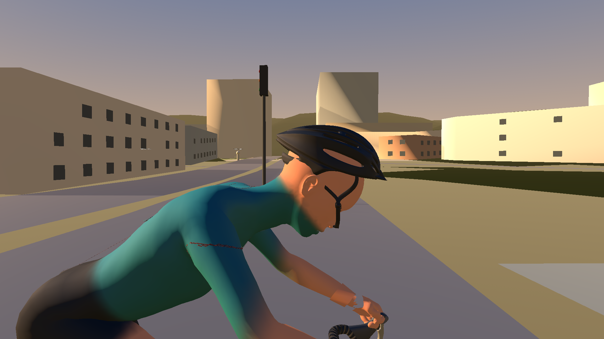 | 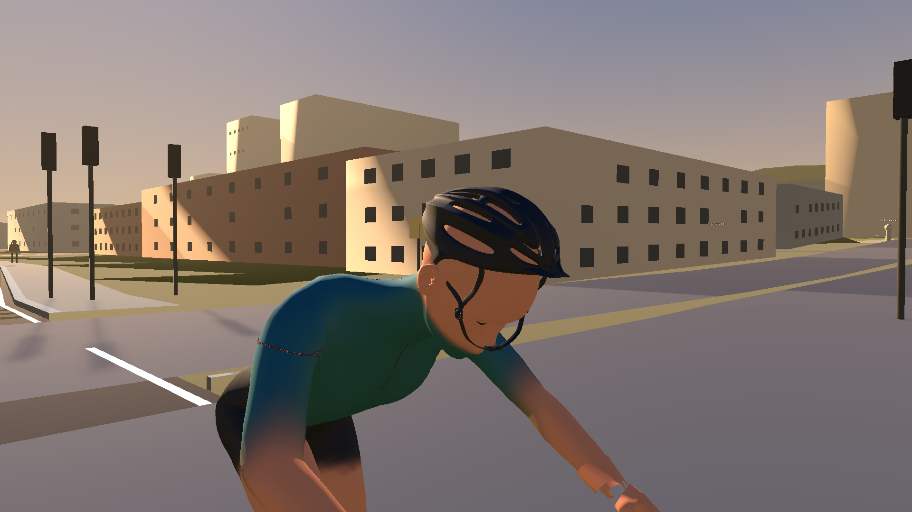 | 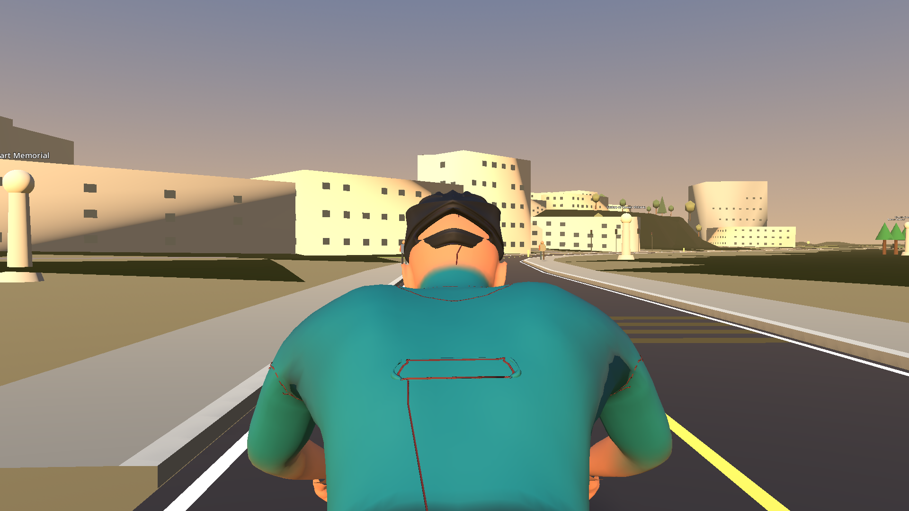 |
| D | +30 mm | 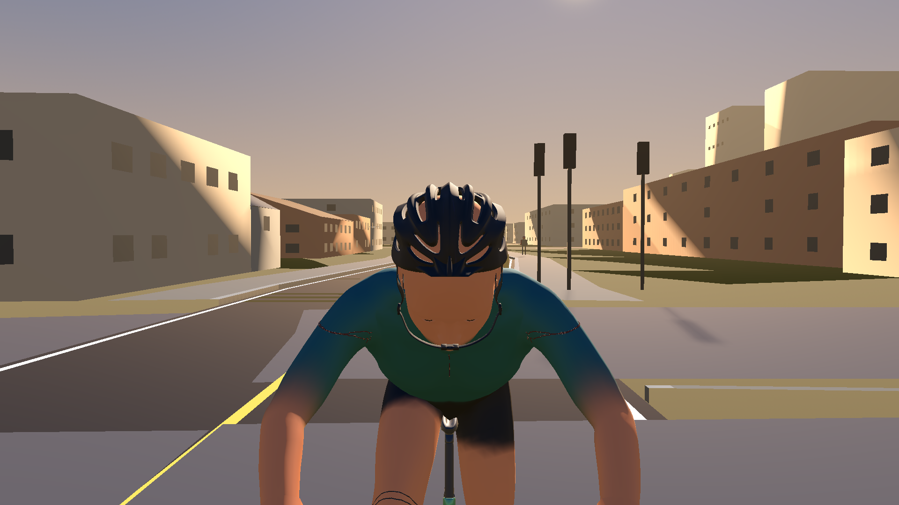 | 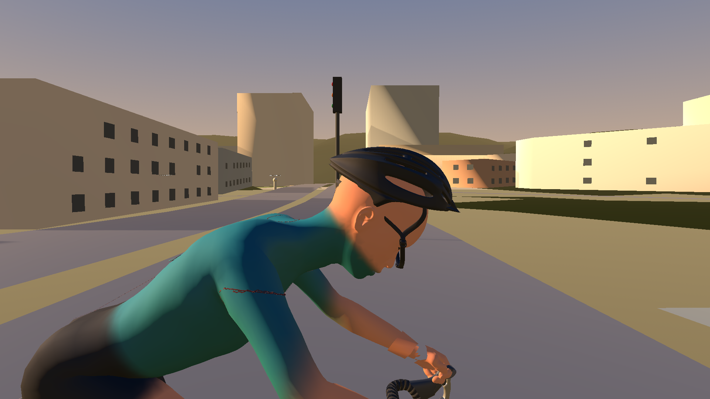 |  | 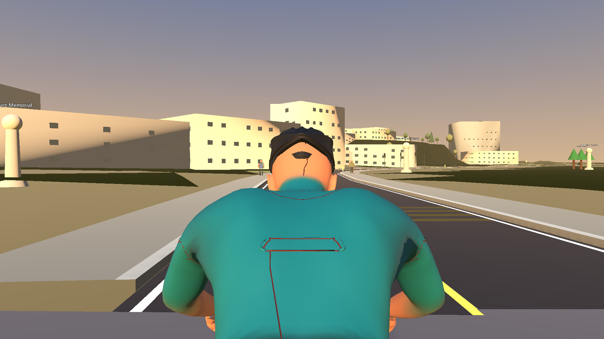 |

## Implementation boundary and validation

`CyclistVisual.cs` applies the selected 10 mm offset by converting the bicycle-forward vector from cyclist space into the animated head-attachment space. The existing 12° pitch and −10 mm vertical fit offset remain. The supplied rigid shell, materials, color options, straps, and orientation are unchanged. The comparison-only environment variables and direct node-offset code have been removed from `RiderFinishingSceneReviewTest.cs`; the diagnostic comparison implementation is no longer active. The captured comparison and fit-investigation evidence remains preserved.

The Debug build passed. The standard Godot 4.6.2 `RiderFinishingSceneReviewTest.tscn` ran against the production RideScreen and passed after the production offset was applied. The run captures front, side, three-quarter, and rear views plus live riding phases 0° through 315°. Output and Godot user data were isolated under `%TEMP%\Wodra-alpha90-helmet-selectedB`.
