# PR #164 helmet fit comparison

These are production `RideScreen.tscn` captures from Godot 4.6.2, rendered
with the OpenGL Quadro P620 renderer. The run used the Dummy Trainer at 85 rpm
on Dunedin One-way: Oval to Gardens Loop and the live cadence update path.
The before images are from the `de77ef8` baseline; after images are from the
rebuilt rigid helmet attached to the existing head bone. The rider, skeleton,
animation, bicycle, and helmet-forward transform were not changed.

## Before and after production head views

| View | `de77ef8` baseline | Fitted helmet |
|---|---|---|
| Side | 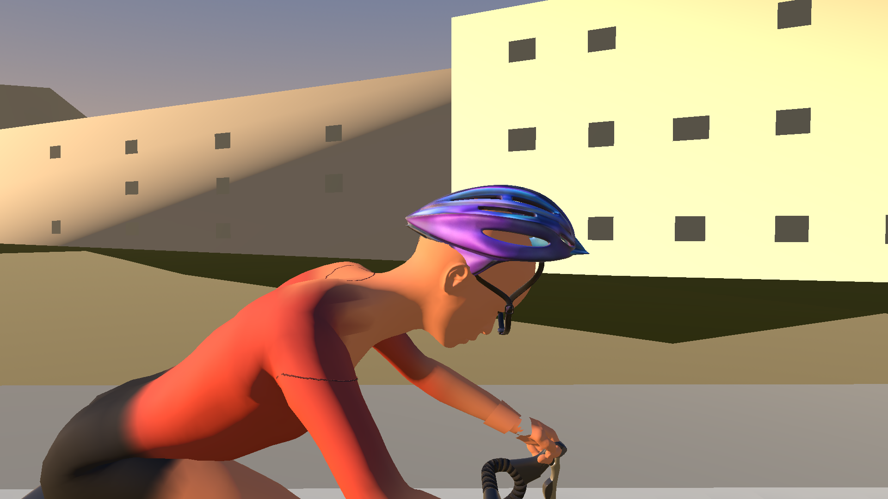 | 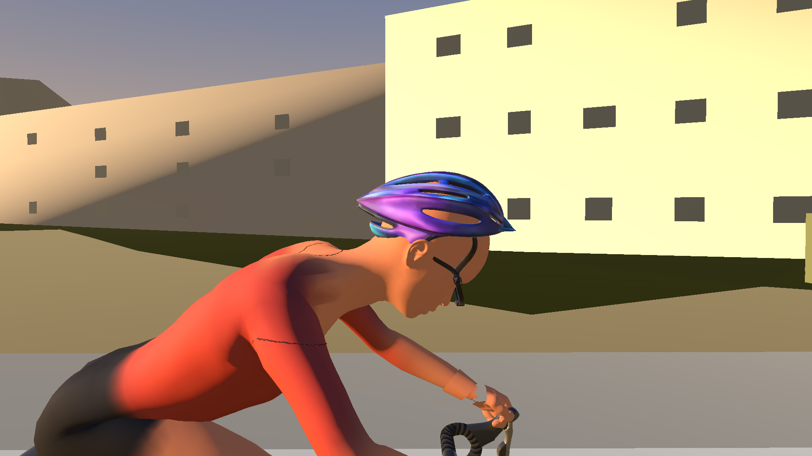 |
| Front | 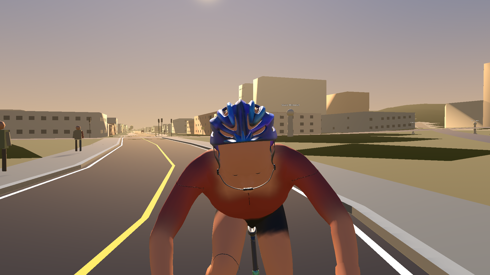 | 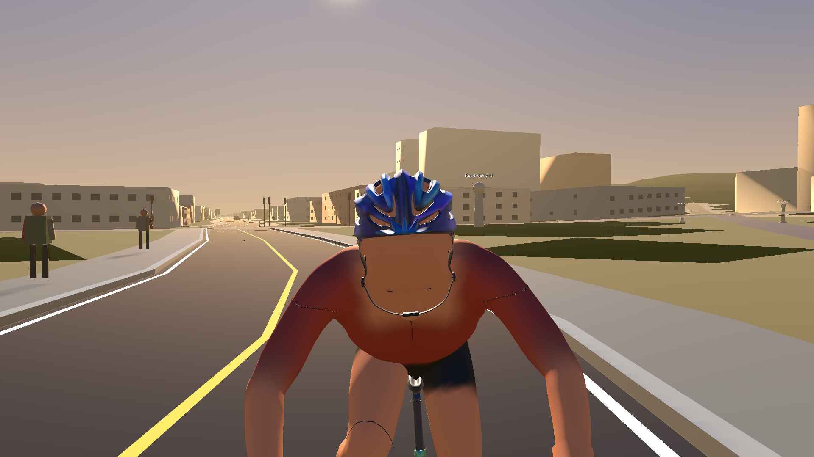 |
| Rear | 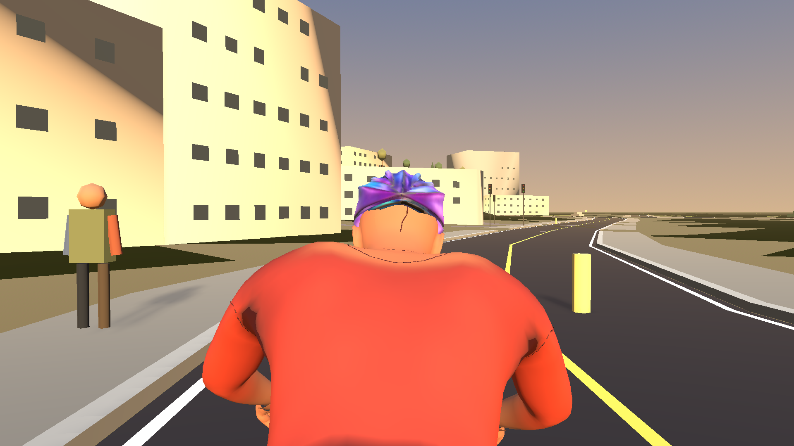 | 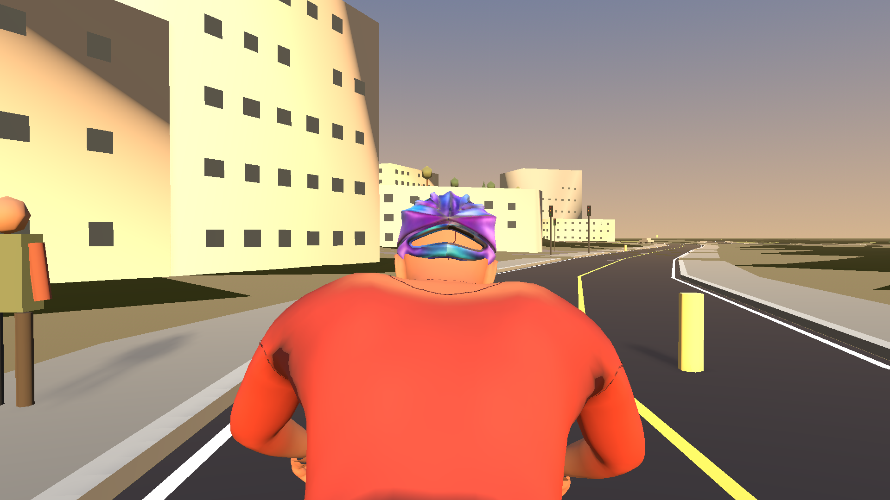 |
| Three-quarter | 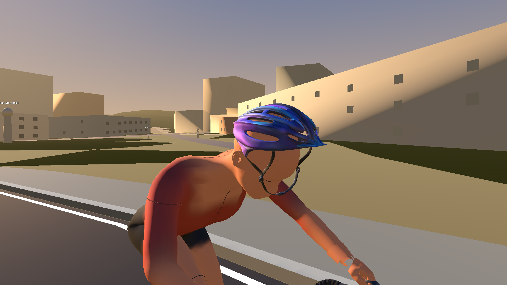 | 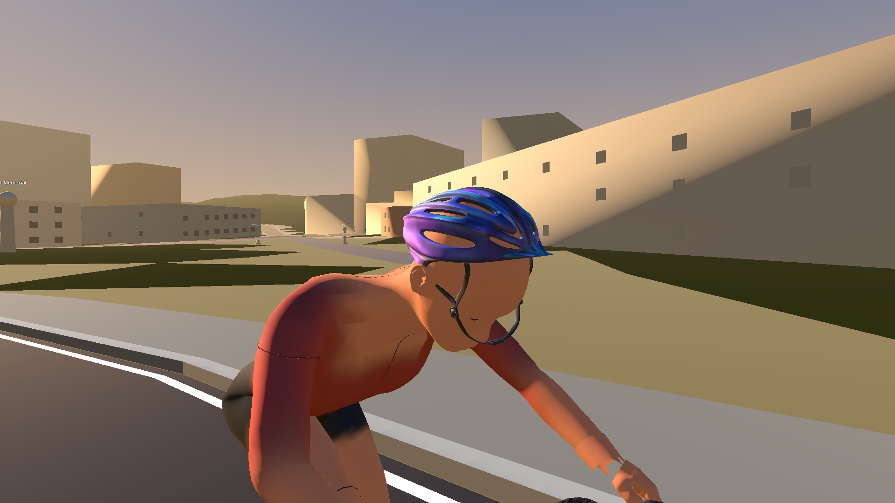 |

## Full rider at live crank phases

| Phase | `de77ef8` baseline | Fitted helmet |
|---|---|---|
| 0° | 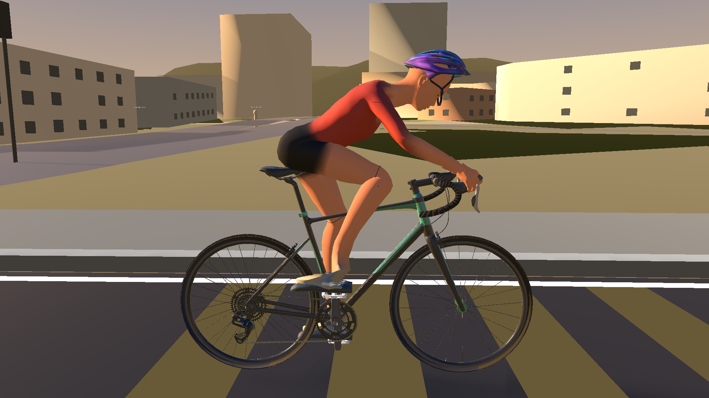 | 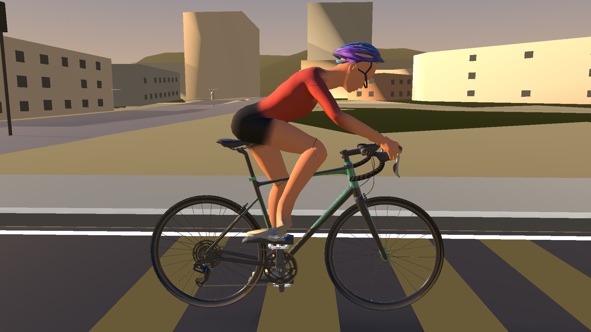 |
| 90° |  |  |
| 180° | 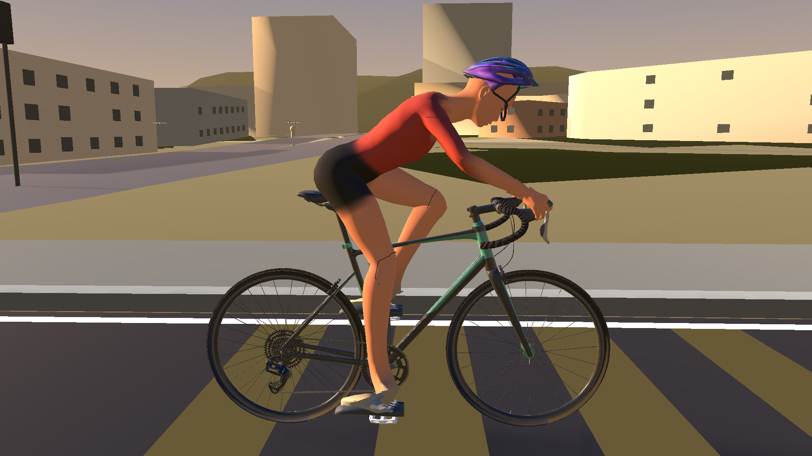 | 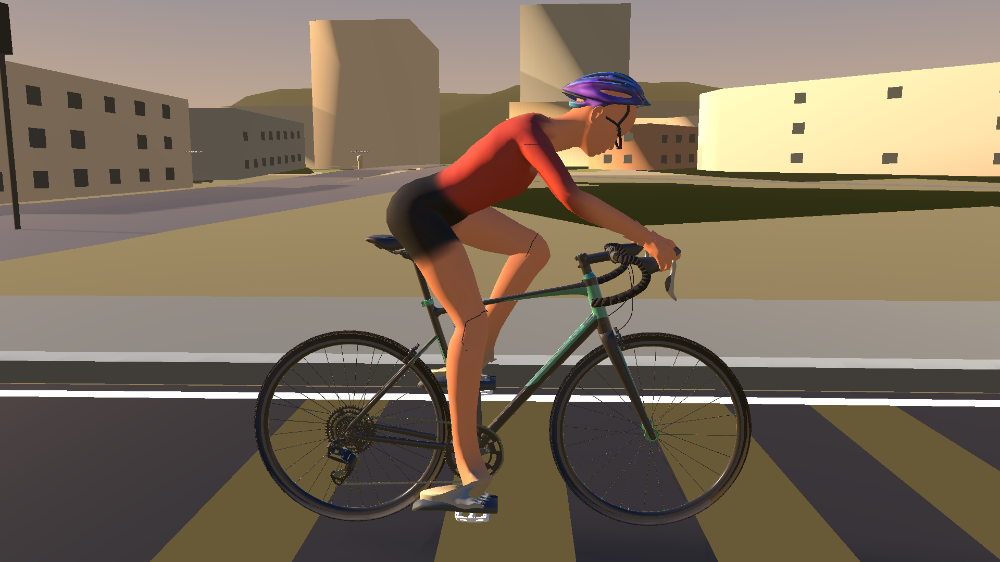 |
| 270° | 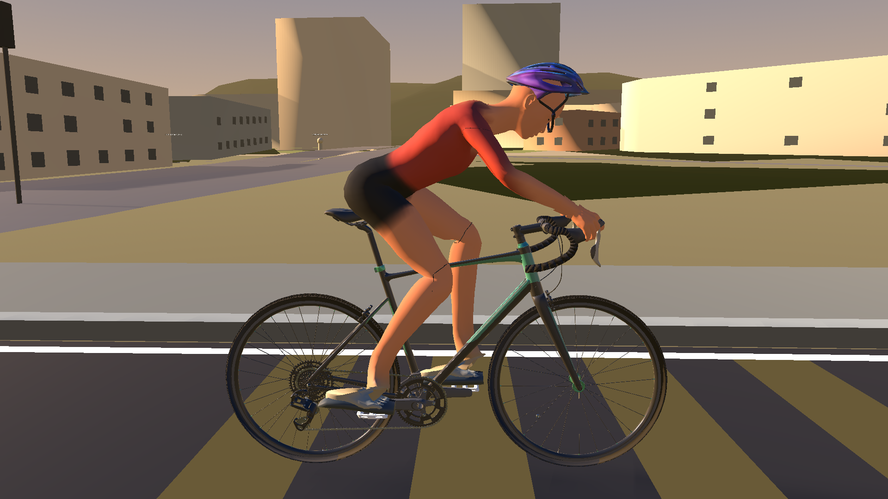 | 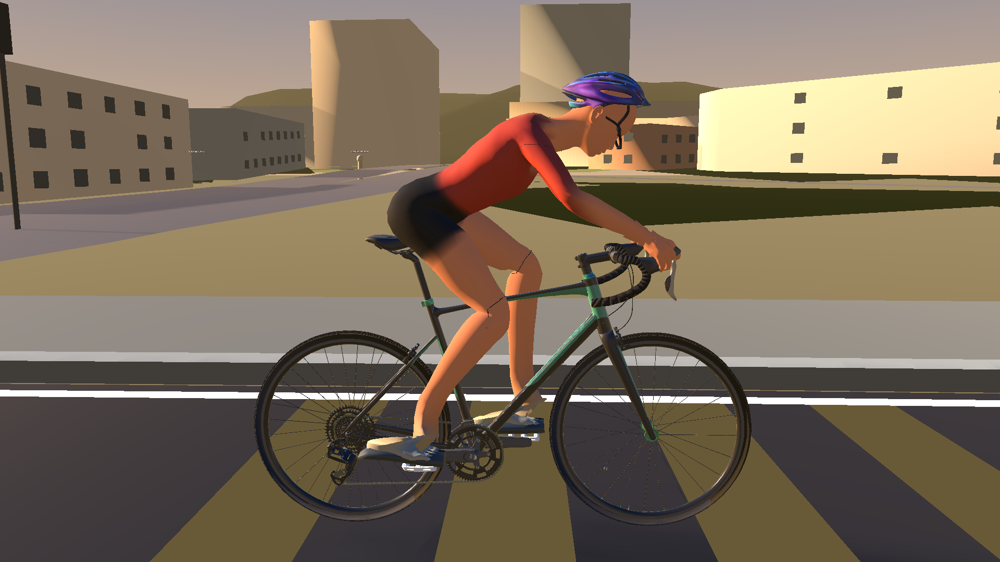 |

## Measured source fit

The production head mesh measures 172.6 mm from eye level to the crown and
68.5 mm forward at the brow. The supplied shell bounds are 177.8 × 273.7 ×
149.6 mm. The shell now scales to 95% in each imported Blender axis and moves
31.5 mm rearward, keeping its front about 25 mm beyond the brow and its crown
about 10 mm above the measured scalp. Its existing origin and forward axis stay
unchanged. The molded front lip is fitted with the shell; strap vertices blend
from the existing under-jaw clasp to their fitted shell anchors, independently
of the shell surface.

The post-change views show the same forward-facing helmet with a shorter,
snugger shell, improved rear coverage, and straps meeting beneath the jaw. A
small amount of skin color remains visible through the model's open vent slots;
these captures should be reviewed for visual acceptance.

## Reproduction

From the repository root, export with Blender 5.2:

```powershell
& 'C:\Program Files\Blender Foundation\Blender 5.2\blender.exe' --background --python tools/modeling/export_cycling_helmet_rigid.py
```

Then import and run `res://Tests/RiderFinishingSceneReviewTest.tscn` with Godot
4.6.2. Set `WODRA_VISUAL_REVIEW_OUTPUT` and
`WODRA_VISUAL_REVIEW_RESOLUTION=1920x1080` to choose the capture directory and
size. The harness records the eight live crank phases and the four full-rider
phase views above.

## Verification

- Blender 5.2 export completed and repeated with identical GLB SHA-256.
- Godot 4.6.2 imported the rebuilt GLB; the production RideScreen review scene
  reported `PASS` at 85 rpm.
- Debug and Release game builds passed (281 existing warnings, no errors).
- The existing rider-fit headless regression passed. The production rider GLB
  hash and runtime attachment/orientation code are unchanged.
- Shutdown RID diagnostics matched the `de77ef8` baseline counts: the same
  Canvas, CanvasItem, viewport, textures, shaped-text, font, and ObjectDB
  warnings appeared in the review runs. The helmet fit change did not add to
  those reported leak counts.
