# PR #164 helmet orientation evidence

This is an orientation review of the owner-supplied helmet and the current production RideScreen. The helmet mesh is **not yawed or otherwise changed** by this review. The evidence identifies the short brow end as the physical front and compares it with the rider's face in Godot. Human visual approval is still required.

## Physical front and rear in the supplied asset

The authoritative input was `sport_cycling_helmet.zip` (SHA-256 `3AD186A9830CDCDB993763AE46F018601DEF8406E6D289EA04A9F6DA621F3D18`). The raw OBJ was inspected in Blender with its source vertices left unchanged. Its front is the short forehead/brow lip and the frontal vent layout. Its rear is the longer occipital shell and retention coverage. The owner ZIP's own opposite-side previews (`preview_4` and `preview_6`) show the short brow end on either side of the image depending on the camera, and the longer shell at the back.

The raw OBJ has 35,632 vertices and 35,537 faces. Its measured bounds are X `[-8.8909, 8.8909]`, Y `[-12.4087, 16.7532]`, Z `[-11.9214, 12.2365]`. Independent inspection of the brow edge, frontal vents, underside, and strap attachments identifies physical forward as OBJ `-Y`; the long tail/retention end is OBJ `+Y`.

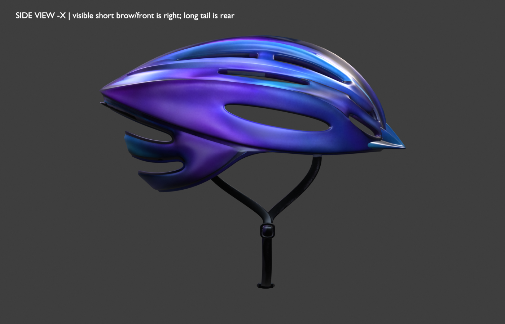

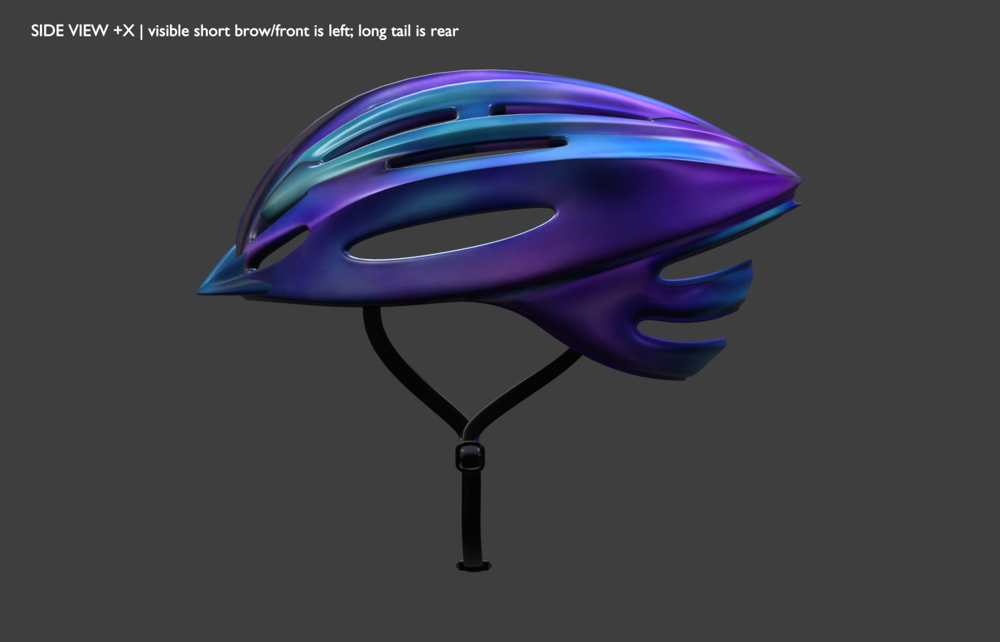

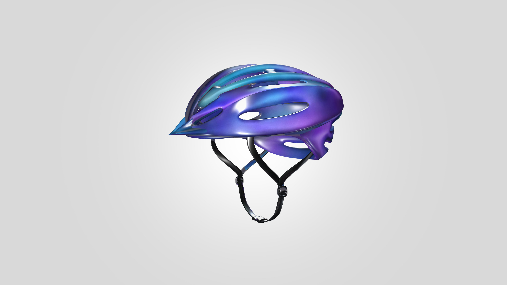

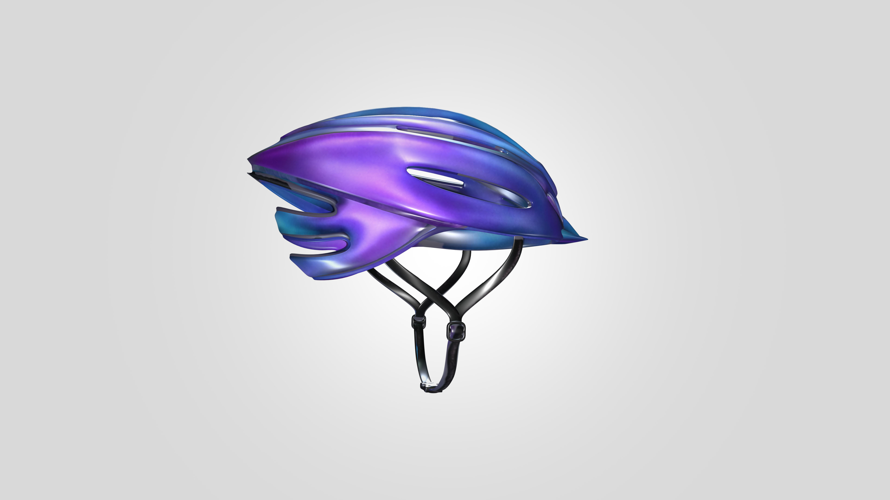

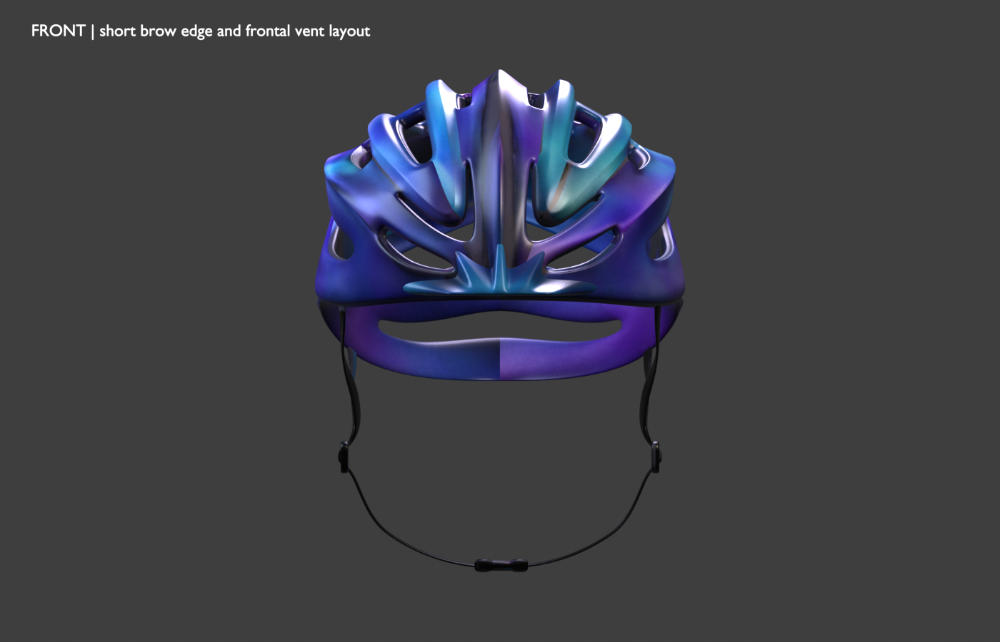

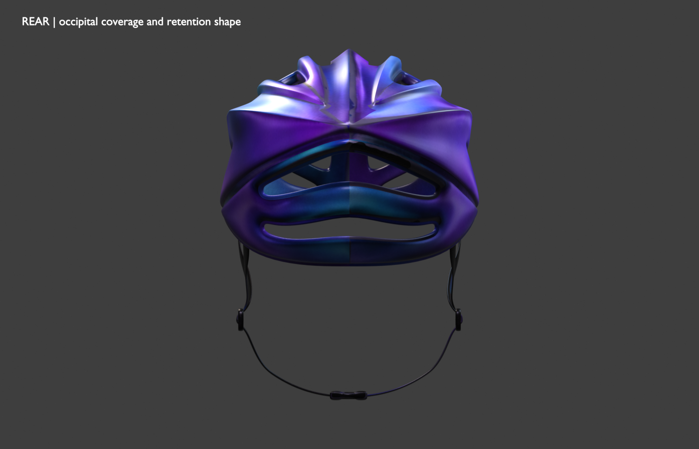

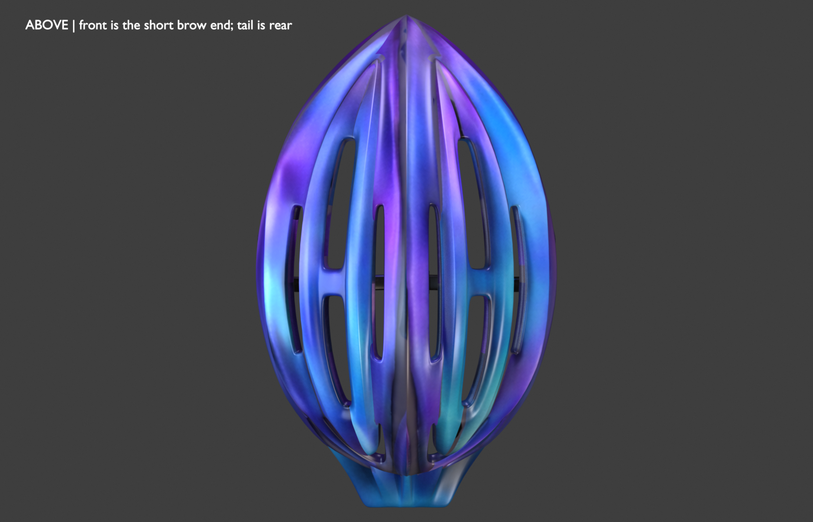

## Actual production view and 180-degree comparison

These are Godot 4.6.2 captures from `RiderFinishingSceneReviewTest.tscn`, which starts the production `RideScreen`, Dummy Trainer at 85 rpm, and the Dunedin One-way: Oval to Gardens Loop. The side camera shows the rider facing right. In the current assembly, the brow marker is 28 mm ahead of the rider's eye center and the rear-tail marker is 211 mm behind it; their side-camera positions are 1197.7 px, 1066.2 px, and 843.3 px respectively. Each physical marker is also checked against the imported helmet surface (4 mm brow distance, 0 mm tail distance).

The adjacent raw-OBJ and production images show the short brow at the rider's forehead/front and the long tail behind the skull. A separate production capture applies a temporary 180-degree yaw to the test instance only. It puts the tail over the forehead; the production asset is restored immediately after the capture. No body, posture, bike, fit, strap, leg, shoe, hand, or animation asset is changed here.

| Unmodified owner OBJ, side view | Current production RideScreen, side view |
| --- | --- |
|  | 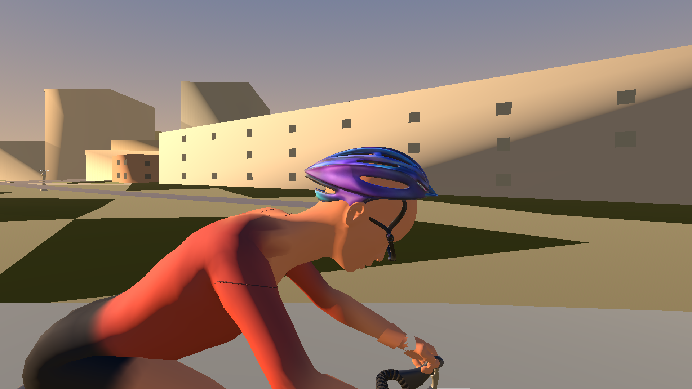 |

| Current production 0-degree pose | Production 180-degree yaw counterfactual |
| --- | --- |
|  | 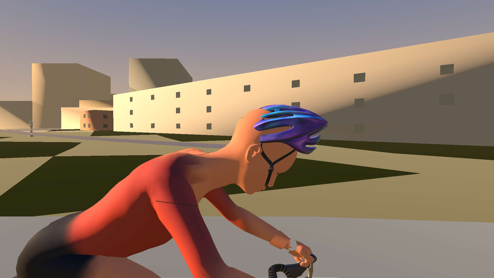 |

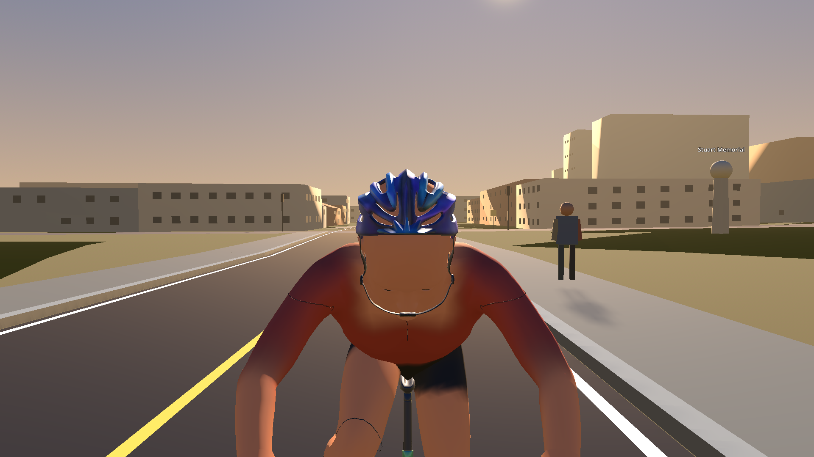

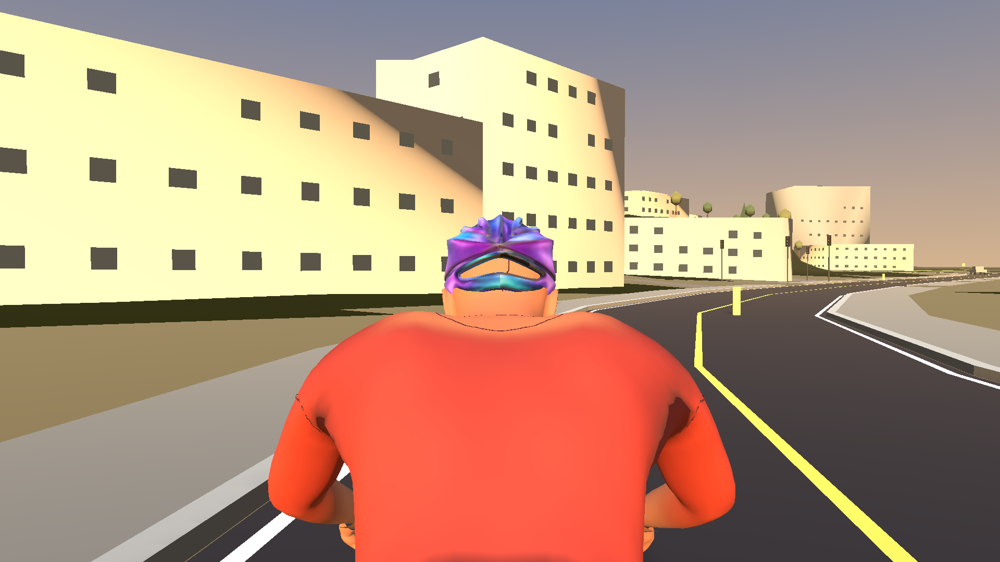

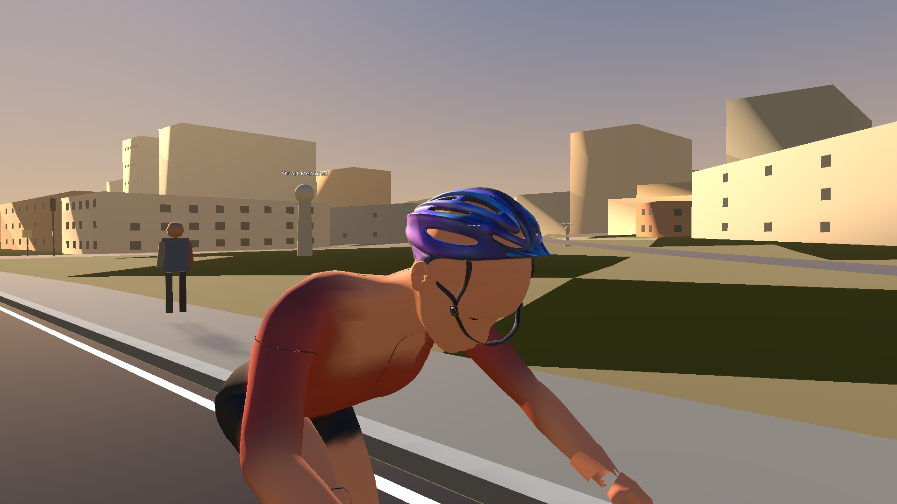

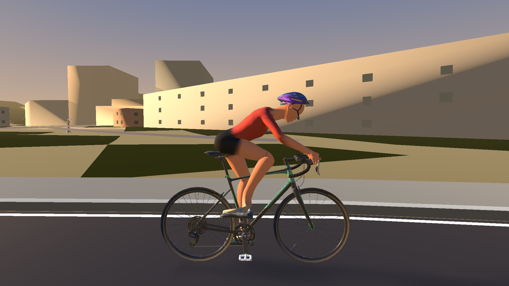

Full rider crank-phase views from the actual running RideScreen are also included at 0, 90, 180, and 270 degrees. The test additionally records the live cadence update path at 85 rpm through all eight 45-degree phases.

## Coordinate conversion and regression

The exporter imports the OBJ with Blender `forward_axis="NEGATIVE_Y"` and `up_axis="Z"`. Thus the visually identified physical OBJ front `-Y` becomes Blender `+Y`; glTF conversion maps Blender `+Y` to Godot `-Z` and Blender `+Z` to Godot `+Y`. This mapping documents the path; it does not select the physical front.

The earlier regression compared the helmet pose's `-Z` basis with bicycle forward. That could pass without confirming that the rendered mesh's brow and rear features actually bracketed the face. The updated RideScreen check uses two physical feature markers placed at source geometry points, verifies each marker remains within 30 mm of the imported mesh, then checks their positions against the rider's actual eye/head direction and side-camera projection. Its negative control applies a counterfactual 180-degree yaw and confirms that the physical-feature predicate rejects it.

Reproduce the raw source renders with Blender 5.2.2:

```powershell
& 'C:\Program Files\Blender Foundation\Blender 5.2\blender.exe' --background `
  --python tools/modeling/render_cycling_helmet_source_views.py -- `
  --source-zip 'C:\Users\garet\OneDrive\wodra_bikes\sport_cycling_helmet.zip' `
  --output-dir artifacts/issue164-helmet-orientation-source
```

The helmet export adds the non-rendering brow and rear-tail markers to `CyclingHelmetRigid.glb`; the GLB binary geometry buffer is byte-for-byte identical to the pre-marker export. It applies no orientation correction because the raw source and the production side projection agree. The owner should review these visuals before any further yaw change.

Production RideScreen capture command (Godot 4.6.2, Compatibility renderer):

```powershell
$env:APPDATA = (Resolve-Path '.godot-appdata').Path
$env:LOCALAPPDATA = (Resolve-Path '.godot-localappdata').Path
$env:WODRA_VISUAL_REVIEW_OUTPUT = (Join-Path (Get-Location) 'artifacts/issue164-helmet-orientation')
$env:WODRA_VISUAL_REVIEW_RESOLUTION = '1920x1080'
$godot = 'C:\Tools\Godot\Godot_v4.6.2-stable_mono_win64\Godot_v4.6.2-stable_mono_win64_console.exe'
& $godot --path src/IndoorCycling.Game --scene res://Tests/RiderFinishingSceneReviewTest.tscn --rendering-method gl_compatibility
```
