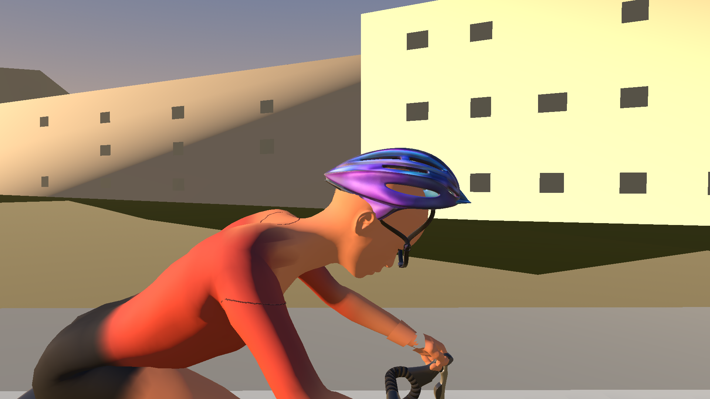
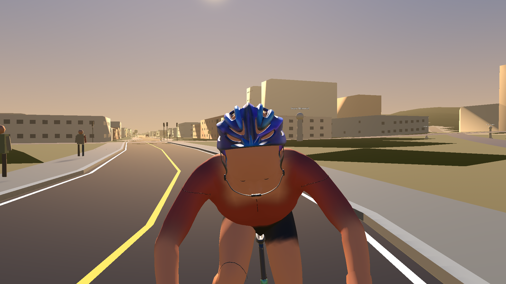
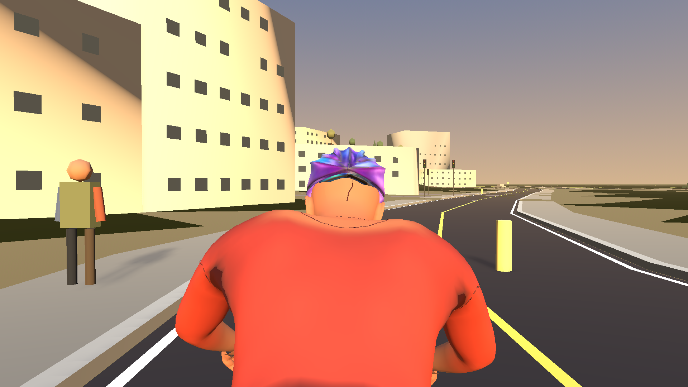
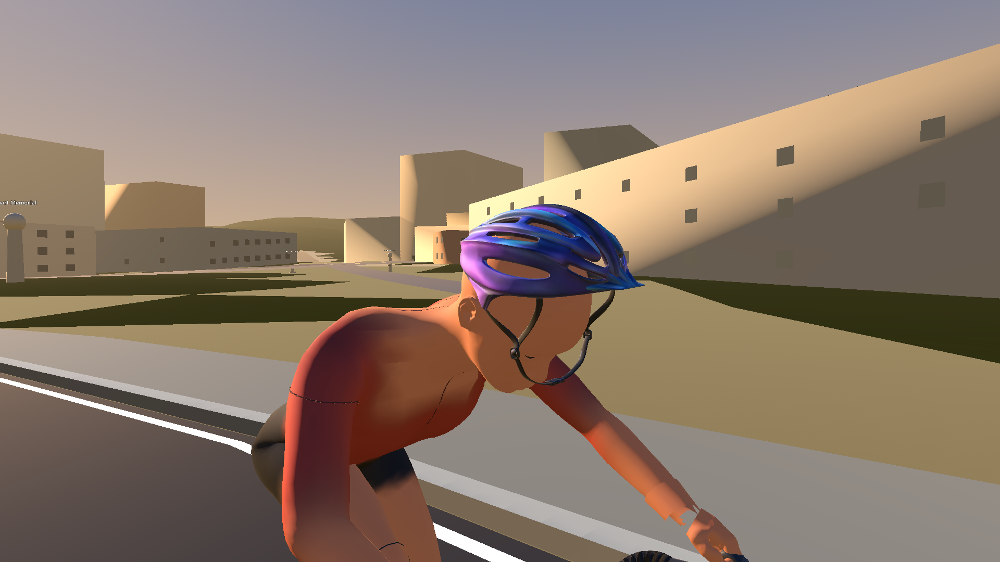
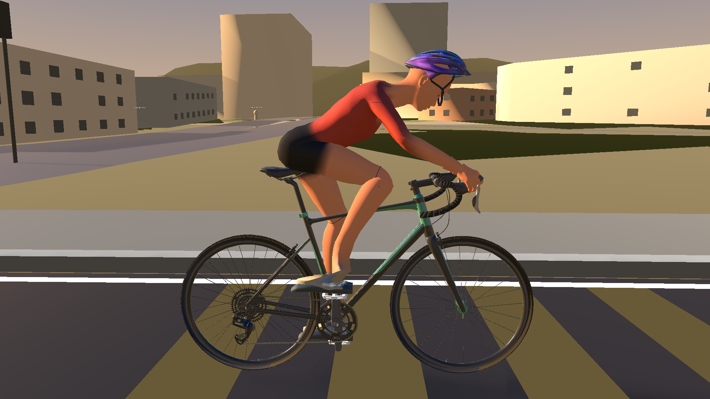
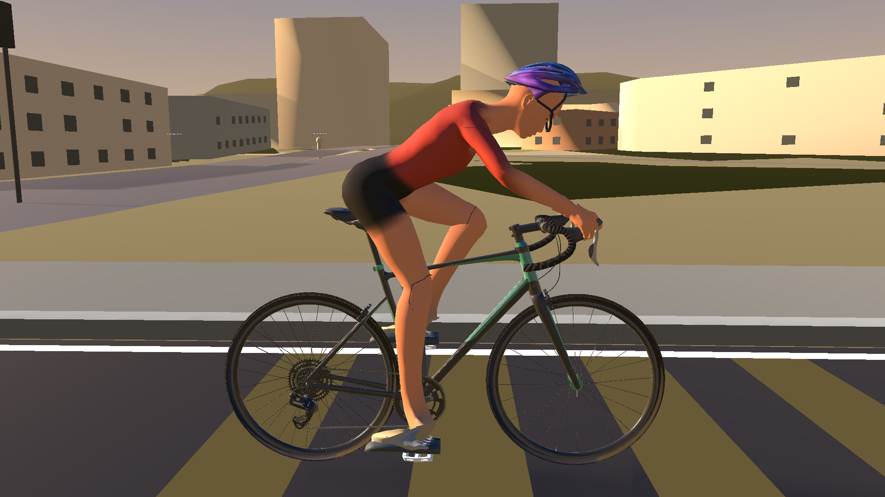
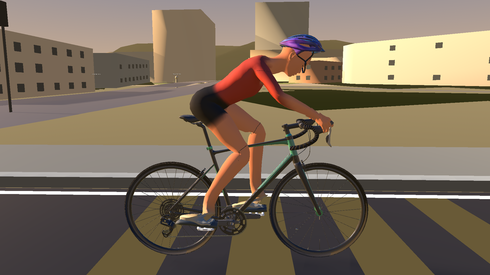

# PR #164 rigid helmet production review

These are unmodified Godot 4.6.2 captures from the production RideScreen
review run. It started the Dunedin One-way: Oval to Gardens Loop route with the
Dummy Trainer set to 85 rpm. The test allowed the live cadence update path to
cross all eight crank phases, then captured the clear exact-phase images below
from the same imported rider and bike.

The side camera shows the rider facing right. The supplied helmet's brow/front
is above the forehead, its rear shell covers the back of the skull, and its
straps pass beneath the jaw. The four close views below are from the runtime
scene; the full-rider views show the integrated helmet on the production bike
at exact crank phases. Automated checks and the render review are recorded in
the PR checks. These images are provided for human visual acceptance.

## Head views

| Side | Front | Rear | Three-quarter |
|---|---|---|---|
|  |  |  |  |

## Full rider on bike, side view

| 0° | 90° | 180° | 270° |
|---|---|---|---|
|  |  |  |  |