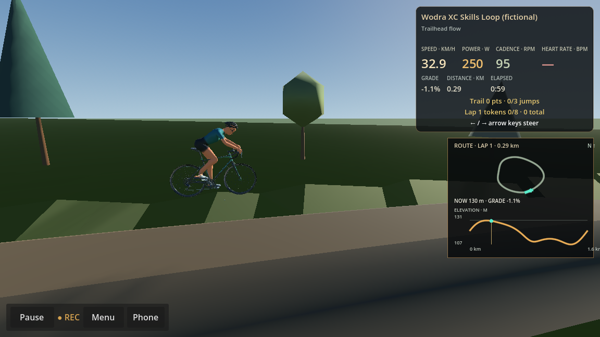
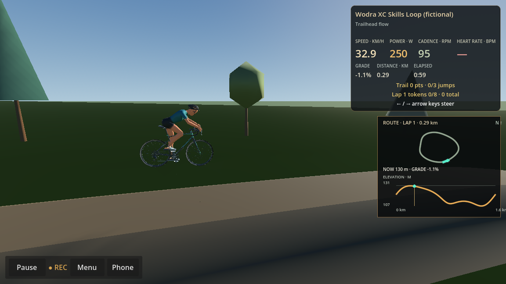
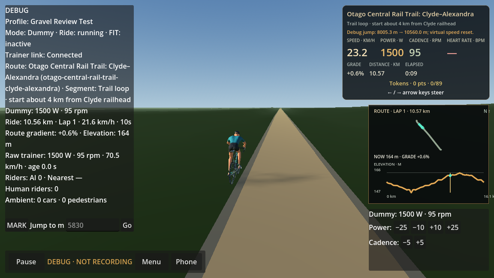
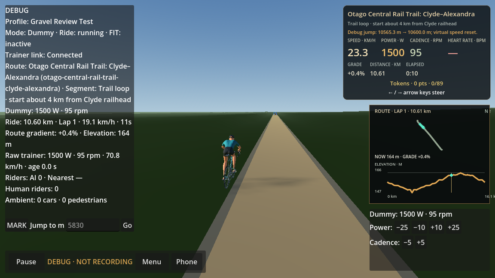

# MTB XC Skills Loop gameplay review

Production evidence captured on Godot 4.6.2, Compatibility renderer, NVIDIA Quadro P620. The RideScreen used the normal HUD and chase camera; a second run used the RideScreen side inspection view. A 250 W dummy trainer provided ordinary power. Test steering was dispatched as keyboard Left/Right input through the production ride view.

## Gameplay and validation

- The fictional route remains 1,600 m with 26.0 m ascent. The earlier full three-lap RideScreen regression recorded 4,800 m, 78.0 m ascent and finalized its FIT file.
- Gaming off: the full centerline lap used the three rollable bypasses and generated no jump or score events. Gaming on: keyboard steering selected all three jumps and awarded 75 points each (225 total). The full regression also rode three laps, collected all eight tokens, checked per-lap and cumulative HUD totals, and finalized FIT recording.
- The latest production visual-capture run completed one full lap through all three takeoff and landing zones, recorded three scored traversals (225 points), retained continuous follow-camera motion and finalized FIT. The trace shows all three traversals with live steering and scoring.
- Pickup placements alternate at ±0.66 m from the tread centre. The multi-lap ride regression steered to and collected all eight, preserving the intended lateral challenge while keeping tokens within the trail corridor.
- The existing Gravel → velodrome → road production transition regression passed after terrain shading changed. The Gravel RideScreen review passed 37 assertions, including screenshots at 10,560 m and 10,600 m and player/camera alignment.
- VisualRoute regression passed, including road marking, scenery and route package checks. Physics regression passed. Debug and Release builds succeeded.

## Terrain and jump presentation

Terrain geometry was already sharing indexed grid vertices and accumulated normals, but the renderer replaced those normals with one normal per triangle and assigned a separate variation to each face. On the 8 m XC heightfield this produced square facets beside the trail that made the jump earthwork look like isolated slabs. TerrainLayer now uses the shared vertex normals and stable per-vertex color variation. This is a shading change; it does not alter terrain heights, route coordinates, rider physics or recordings.

The jump line now has a 2.1 m dirt tread, 0.5 m longitudinal samples, a smooth multi-ring earth shoulder that widens with ramp height, and continuous connectors into the existing trail. These meshes are constructed at route load. The gameplay presentation still applies the authored takeoff lift, air arc and rider pitch; landing removes that presentation lift without adding elevation or distance to the ride/FIT data. The original route line remains a continuous rollable bypass.

The earlier Gravel report of sawtooth terrain at 10.56–10.60 km was not reproducible as a height discontinuity in the production RideScreen checkpoints. The screenshots show a continuous riding surface and smooth terrain shading there. The shared terrain shading correction also removes coarse flat-face artifacts without modifying the sourced Gravel terrain elevations.

## Continuous RideScreen jump footage

Each clip covers the approach, takeoff, airborne phase and landing with the normal HUD. Chase clips use the standard gameplay camera; side clips show the actual RideScreen side angle. The separately captured images show approach, takeoff, apex and landing for each jump.

| Jump | Chase camera | Side view |
|---|---|---|
| North tabletop | [MP4](evidence/mtb-xc/xc-jumps-chase-north-tabletop.mp4) | [MP4](evidence/mtb-xc/xc-jumps-side-north-tabletop.mp4) |
| Ridge tabletop | [MP4](evidence/mtb-xc/xc-jumps-chase-ridge-tabletop.mp4) | [MP4](evidence/mtb-xc/xc-jumps-side-ridge-tabletop.mp4) |
| Lower tabletop | [MP4](evidence/mtb-xc/xc-jumps-chase-lower-tabletop.mp4) | [MP4](evidence/mtb-xc/xc-jumps-side-lower-tabletop.mp4) |

The capture log reports 25 successful assertions. Video frame counts are 252/156/203 (chase) and 297/174/223 (side) for North/Ridge/Lower. Each frame was captured continuously during the production RideScreen ride; the clips are encoded at 15 fps.

## Review limitation

The sessions used the dummy trainer and scripted keyboard input rather than physical trainer/steering hardware. Keep PR #178 in draft for owner review of the linked gameplay footage before any release decision.
