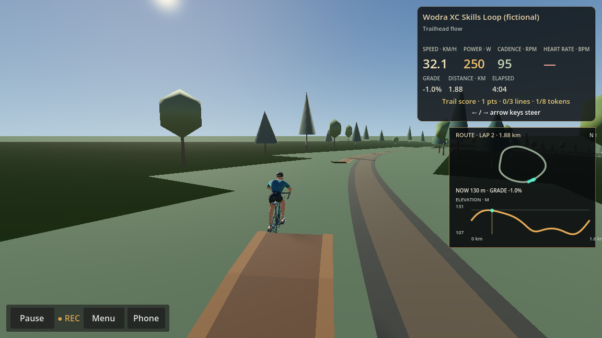
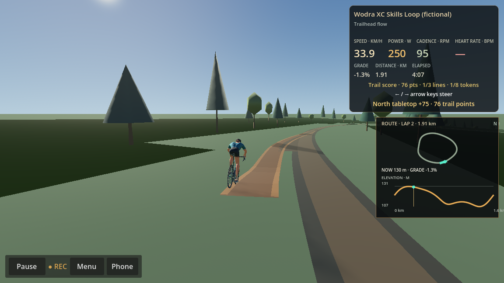
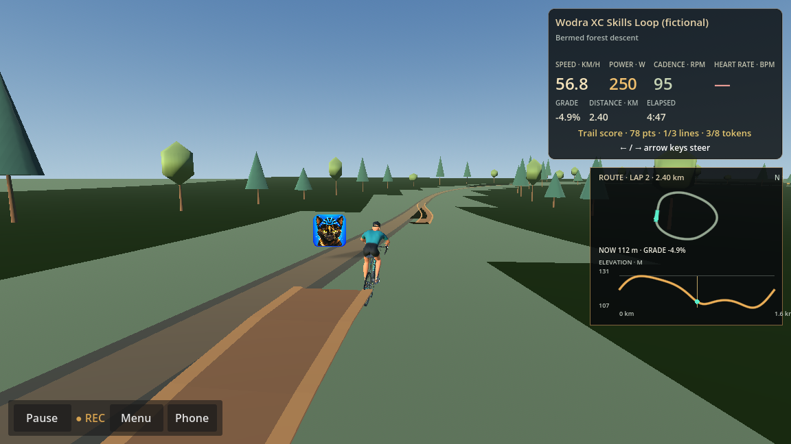
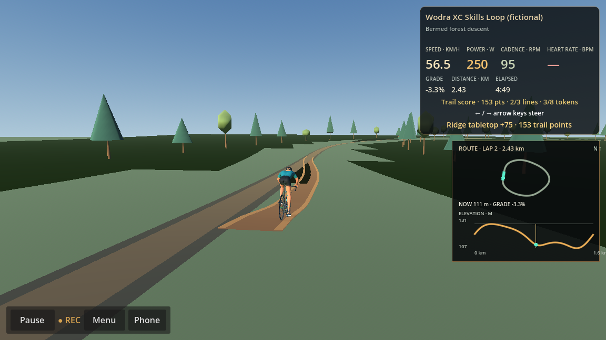
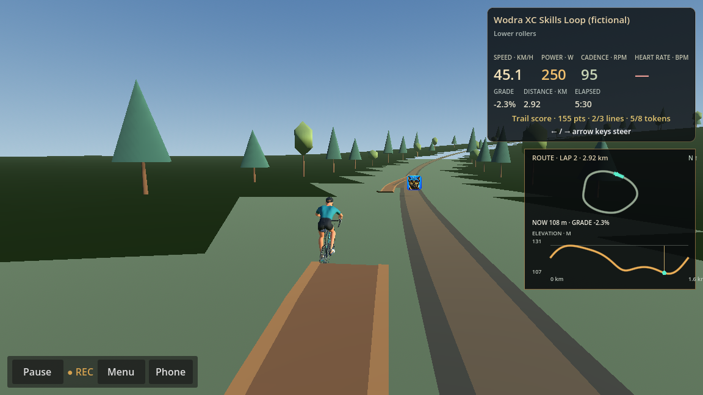
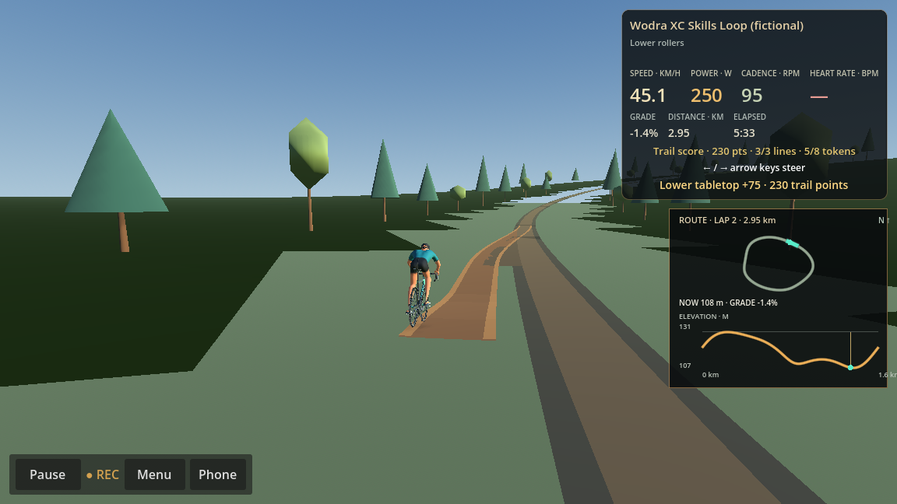
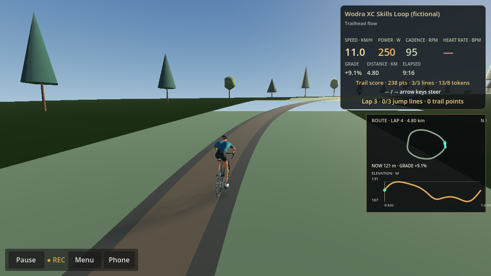

# MTB XC Skills Loop gameplay review

Production RideScreen evidence collected with Godot 4.6.2, the Compatibility renderer, and the NVIDIA Quadro P620. The rider used the normal chase camera and HUD. A 250 W dummy trainer provided ordinary indoor ride power; Left/Right steering was sent through the same `InputEventKey` path used by keyboard play.

## Gameplay results

- The route remains 1,600 m with 26.0 m authored ascent. Three laps recorded 4,800 m and 78.0 m ascent in the finalized FIT file.
- With Gaming off, a full centerline lap used the rollable bypasses, scored zero and produced no jump traversals. Pause/resume retained route progress.
- With Gaming on, keyboard steering selected all three jumps. The RideScreen diagnostic log recorded three takeoffs at 32.0, 56.8 and 45.1 km/h, three completed traversals and three 75 point awards (225 points total). Maximum sampled visual airtime was 1.000 m at 32.9 km/h.
- The next centerline lap collected all eight deterministic pickups. Five were collected on the jump line lap and the jump branch explicitly logged the other three as missed with their route chainage and lateral offset. The centerline pickup positions now stay within 0.10 m of the route to account for neutral keyboard offset.
- The test completed three lap summaries and returned across the route seam without changing authoritative distance or adding jump lift to the FIT elevation.
- The production MTB → gravel → velodrome → road scene transitions passed. The separate full MTB RideScreen review also completed Signal Hill at its natural endpoint and finalized its FIT.

## Visual evidence

The video is a 91-frame, 6.07 second sequence captured from the running RideScreen across all three jump lines. The stills show the same gameplay camera and normal HUD.

[Watch the RideScreen jump and landing sequence](evidence/mtb-xc/xc-jumps-ridescreen.mp4).

## Fixes

- Each branch now has a raised take-off ramp, a visually open take-off-to-landing gap, and a separate raised landing roll-out. The centerline bypass remains continuous. The rider's presentation lift and pitch persist through the airborne phase and do not alter simulation or recording.
- Takeoff and completed-traversal diagnostics are independent of Gaming. Optional score awards still require Gaming to be enabled.
- Collectibles remain visible and swept-pickup detection remains active only when Gaming is enabled. Placement telemetry now records every route-relative pickup coordinate for diagnosis.

## Limits

The ride used the dummy trainer rather than physical trainer/steering hardware. The Windows validation test passed, but the owner should review the attached gameplay before release. No comparable before/after P620 frame-time run was captured specifically for the new jump geometry; the existing shared-scenery performance report remains the only frame-time comparison.
